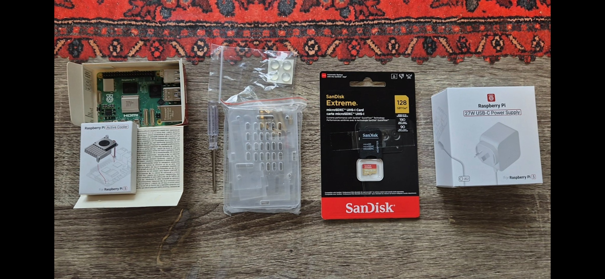
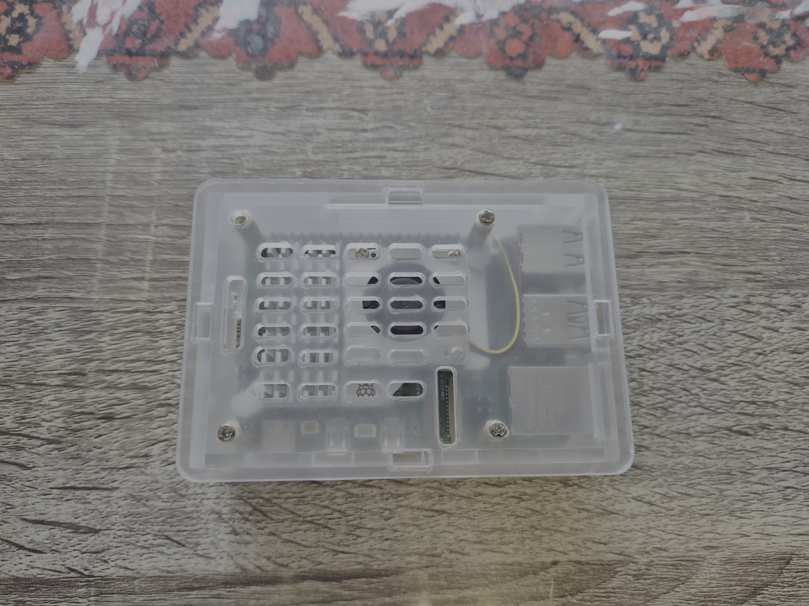
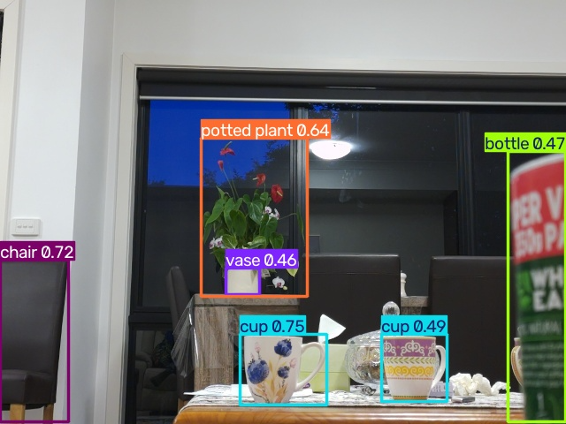
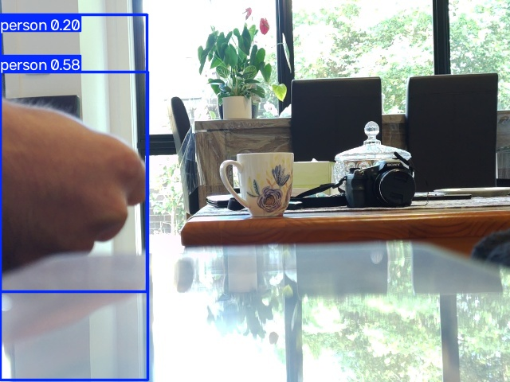
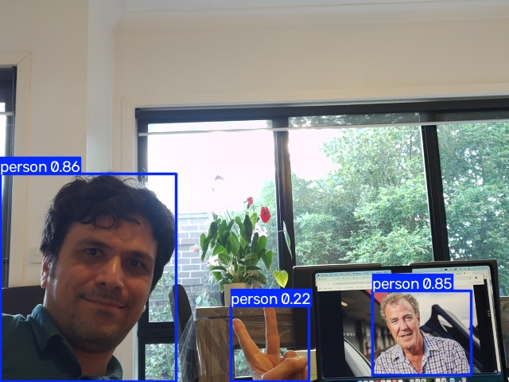

# Ollama Python

A collection of notebooks and Raspberry Pi projects for exploring local language
models, validated tools, sensors and camera perception with Ollama.

The [Week 1 notebook](src/week_01.ipynb) covers:

- Sending chat requests and inspecting model thinking.
- Creating a reusable LLM backend interface.
- Building an interactive conversation loop with message history.
- Measuring response time, token counts, and generation speed.

The [Week 2 notebook](src/week_02.ipynb) builds on Week 1 with:

- Defining addition and division functions as tools for the model.
- Guiding tool selection with descriptions and a general system instruction.
- Executing requested tools and preserving their requests and results in message history.
- Handling multiple tool rounds, with a five-round limit, before returning a text answer.

Try `What is 10 / (3 + 2)?` to explore a calculation that can use both tools.

The [Week 2 extended notebook](src/week_02_extended.ipynb) adds:

- A `save_to_file` tool for writing model-provided content to a local file.
- Pydantic input models for addition, division, and file saving.
- Validation of tool arguments before execution, including rejecting division by zero.
- Passing validated arguments to each tool and returning validation errors to the model as tool results.

Try `Save the text "Hello from Ollama" to answer.log` to explore file saving. The file is written relative to the notebook kernel's working directory; an existing file with the same name is overwritten.

The [Week 3 notebook](src/week_03.ipynb) adds a step-by-step SQLite memory layer:

- Sessions and saved user/assistant messages.
- Persistent facts with a simple parameterized `LIKE` search.
- Tools to remember facts, search memories, create tasks, and list tasks.
- An in-memory example you can run without Ollama, followed by the interactive chat.

Run its numbered steps in order. The persistent database is `week_03_memory.sqlite3`
in the kernel's working directory (the notebook prints its full path). Reuse that
file across runs to retain memories and tasks. Each chat starts a new session;
stored chat history is available for inspection but is not automatically reloaded
into the model. Local database files are ignored by Git.

The [Week 4 benchmark](src/week_04/benchmark_README.md) compares small local
models on a Raspberry Pi with an API model. It includes controlled timing,
32 knowledge/reasoning/grounding/uncertainty cases, offline rescoring and
Markdown/CSV/JSON comparison tables. The documentation records the commands
and results for Qwen3.5 2B/4B, Gemma4 E2B/E4B and GPT-6 Luna. This experiment
keeps the original v2 prompts and the corrected scorer; no reruns of previous
models are required to add another model under the same conditions.

| Raspberry Pi hardware | Assembled Raspberry Pi 5 |
|---|---|
|  |  |

The [Week 5 AI button](src/week_05/README.md) connects a physical
button to a local model and a validated LED tool on Raspberry Pi 5. It includes
wiring instructions, the original hardware photo, staged tests, failure handling,
JSONL tracing, and reported Gemma4 E2B versus Qwen3.5 4B request timings.
Its standalone scripts use Python 3.10+ and the Pi setup described in that README.

The [Week 6 environment agent](src/week_06/README.md) lets a local model choose
when to read a PIR motion sensor through a validated `detect_motion()` tool.
It covers Pi wiring, hardware and agent checks, timestamped observations,
bounded tool calling, JSONL tracing, and the limits of inferring occupancy
from motion signals.

The [Weeks 7–8 vision guide](src/week_07_08/README.md) adds Camera Module 3
capture, OpenCV frame differencing, YOLO26/NCNN benchmarks and text-prompted
YOLOE detection. A reusable `observe_scene(targets, conf)` method captures a
fresh image and produces timestamped JSON; a separate Ollama call summarizes
positive detections. The guide includes the complete runnable Python command,
camera/vision environment setup, annotated examples and their original metadata.



Recorded Pi 5 results: YOLO26n NCNN 640 took **70.18 ms** per warmed prediction
on the table image. In a separate 38-frame YOLOE experiment, the 36 non-initial
calls had median **620.98 ms** prediction time and **4.94 s** total observation
time, including camera process startup and settling, before Ollama. These are
different models and measurement protocols, not a controlled speed comparison.

The examples also document misses, false detections, context-sensitive glasses
recognition and LLM summary errors. A successful request does not establish that
its detector counts or generated explanation are correct. Camera and PIR observations are integrated in Week 09; persistent memory and GPIO actuation are outside the scope of that voice assistant.

## Week 09 — Offline voice assistant

The [Week 09 offline voice assistant](src/week_09/README.md) connects a USB
microphone, whisper.cpp, Ollama `gemma4:e2b`, the Week 06 PIR sensor, the
Weeks 07–08 YOLOE camera pipeline, Piper and a Bluetooth speaker. The guide
includes runnable commands, grounded tool-use policies, annotated camera
experiments, real Pi 5 benchmarks and a memory/latency optimisation recipe.
The persistent vision worker recorded **2.83–2.84 s** warm observations in
our local measurements with a **1-second camera settling delay** (the
published `camera_lab.py` may still have a 3-second delay).

| Overlapping person detections | Person on screen and false-positive hand |
|---|---|
|  |  |

## Week 10 — Persistent memory

The [Week 10 memory guide](src/week_10/README.md) brings
conversation persistence and environmental memory together: SQLite Away Mode
sessions, PIR-triggered observations, voice-triggered camera evidence,
context-aware follow-ups, and a unified push-to-talk interface inherited from
Week 09. It includes reproducible commands, real Pi observations, regression
checks, and a 28-case deterministic routing benchmark. Sensor detections are
unverified predictions, not proof of identity or room occupancy.

## Week 11 — Pi agent: tools, memory, Telegram and local voice

**Status:** functionally complete (22 October 2026). Week 11 delegates the agent loop, model-facing tool selection, and conversation handling to [Pi](https://pi.dev/), while retaining the earlier Python implementations of PIR/camera sensing, YOLO vision, SQLite observations and Whisper/Piper audio. The goal is *less hand-maintained agent orchestration*, not necessarily faster inference on a Raspberry Pi 5.

```text
Local TUI / USB mic / Telegram -> Pi + Ollama (local Gemma 4 E2B 8K)
    -> TypeScript Pi extensions -> Python physical worker
    -> PIR / Pi Camera + YOLO / Week 10 SQLite observation history
    -> text + saved observation images; local audio via Piper + PipeWire
```

| Capability | Final result |
| --- | --- |
| Native Pi tool calling | `detect_motion`, `observe_scene`, `check_presence`, `query_memory` |
| Evidence-backed history | `outputs/week_10/events.sqlite3`; historical event IDs, scores and saved photo paths |
| Telegram | Text, incoming `.oga` voice transcribed offline, stored observation photo attachments |
| Local speech | Whisper.cpp input and Piper output; Tribit Bluetooth speaker when default PipeWire sink |
| File safety | `tg_attach` guard allows only approved photographs under `outputs/observations/` |
| Week 10 comparison | Pi correctly handled history questions that our Week 10 router sent to `general`; cold/tool-heavy Pi requests are often much slower |

**Start here:** [Week 11 README](src/week_11/README.md#week-11-consolidated-runbook) (complete commands, reproducibility, Telegram/security tests, performance measurements and troubleshooting). Also see the specialized Week 11 notes `VOICE_RPC.md`, `LOCAL_SPEAKER.md`, and `TELEGRAM_ATTACHMENT_SAFETY.md` where present.

**Working local TUI command** (on the Pi, from `src/week_11`):

```bash
cd ~/ollama_python/src/week_11
pi --model ollama/gemma4:e2b-8k \
  --system-prompt "$PWD/voice_system.md" --no-context-files \
  --tools detect_motion,observe_scene,check_presence,query_memory,tg_attach \
  --no-mcp --tui-mode regular
```

**Why these flags?** The embedded assistant uses a compact runtime prompt and narrow tool allowlist; use normal project `AGENTS.md` in separate Pi development sessions. Tool allowlists and the upload guard serve different purposes; neither is an operating-system sandbox.

## Week 12 — Local edge-agent model selection

The [Week 12 capstone](src/week_12/README.md) evaluates small Ollama models on
Raspberry Pi 5 using five tool-routing cases, mocked multi-tool agent calls,
sensor-failure grounding checks, and cold-versus-warm inference timing. All four
models passed basic routing, but harder cases exposed missing memory-tool calls
and unsupported claims about sensor state. LFM2.5-1.2B achieved **8.42 s** warm
latency versus **19.02 s** for Gemma4 E2B in the measured failure scenario;
Gemma4 passed grounding in the latest warm run, while LFM2.5 did not. The
capstone includes a runnable standard-library benchmark, offline unit tests,
raw observation summary, and a documented Qwen3.5 long-context experiment.
The tools are mocked; **no physical sensors are accessed**. These exploratory
results are not a production reliability ranking.

## Week 13 — Prompt caching and context management

[Week 13 experiments and findings](src/week_13/README.md): reproducible
prefix-cache tests, full/recent/summary context policies, measured prefill
latencies, cache-behaviour gotchas, and a practical Pi-agent memory policy.

## Getting started

Use Python 3.14 or newer with the `ollama` package installed and a Jupyter-compatible editor, such as VS Code. The extended and Week 3 notebooks also require Pydantic 2. Start Ollama locally and download the models used in the notebooks (`qwen3.5:2b` and `gemma4:e2b`), or update the model names to ones installed.

For Raspberry Pi scripts, follow each week's interpreter and package instructions
instead of upgrading the Pi's system Python to match the notebook setup. The
camera project uses Raspberry Pi OS's Python and apt-installed Picamera2/libcamera
bindings, with a separate environment for vision dependencies.

Start with `src/week_01.ipynb`, then explore tool calling in `src/week_02.ipynb` and input validation in `src/week_02_extended.ipynb`. Run each notebook's cells in order. Enter `exit` or `quit` to end a conversation loop.

## Troubleshooting

`ValueError: No content returned from the model.` is raised by the notebook when an Ollama response contains neither text nor tool calls. It can occur on the follow-up response after a tool has already completed, including saving a file. Inspect the raw `output` and the `messages` inside `OllamaBackend.generate()` before the exception to investigate; this error alone does not identify why the response was empty.
