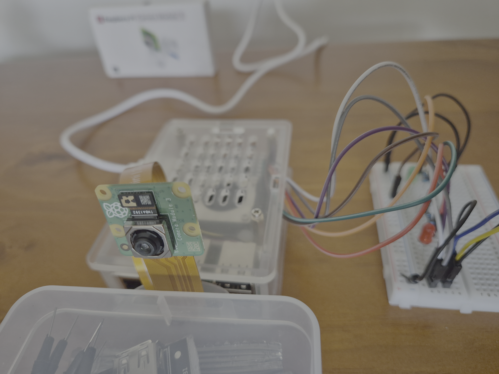
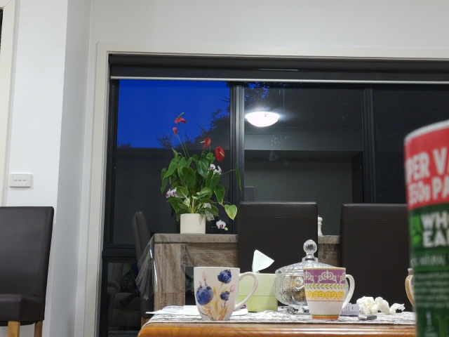
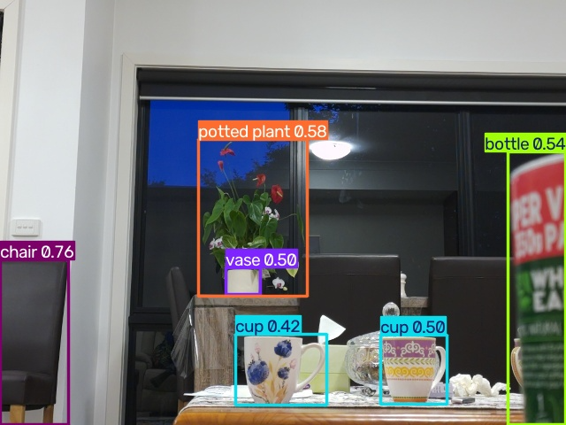
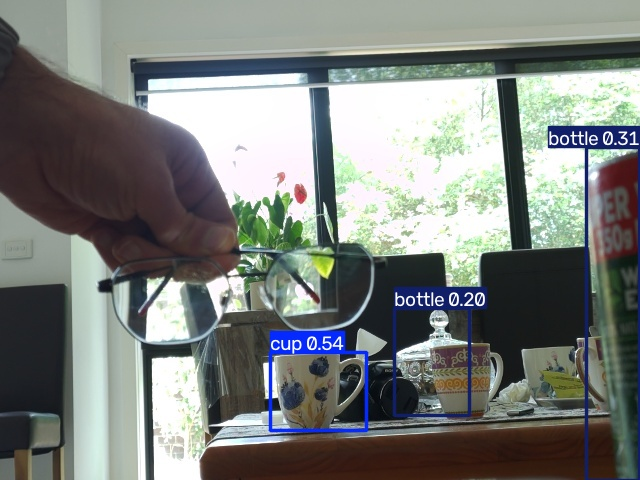
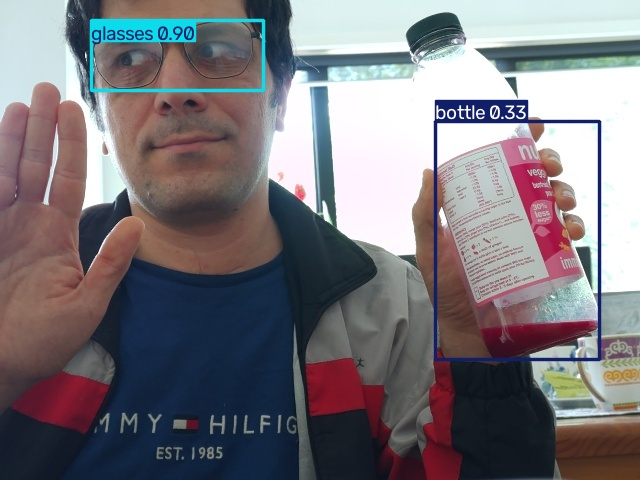
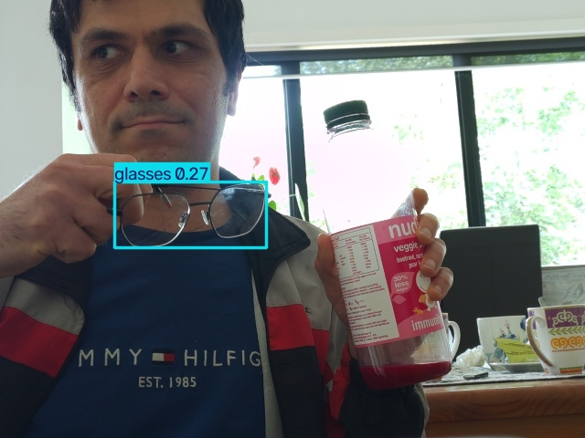

# Weeks 07–08: camera perception and local Ollama summaries

Capture images on Raspberry Pi 5, detect visual changes and objects, and give
structured observations to a local language model. Week 07 covers the camera and
OpenCV; week 08 adds fixed-vocabulary YOLO26, prompted YOLOE and an observation tool.



The actual setup uses **Pi 5 (8 GB), Camera Module 3 and CAM/DISP 0**. Both Pi 5
camera connectors support this use; a working camera does not need moving to
CAM/DISP 1. The camera uses CSI, independently of the existing GPIO circuit.

| Stage | Question | Output |
|---|---|---|
| Camera + OpenCV | What image arrived? Did pixels change? | JPEG, camera metadata, motion mask/logs |
| YOLO26 or YOLOE | Which categories were detected? | Boxes, scores, tentative counts |
| Ollama | How can the observation be summarized? | Short text and submitted JSON |
| Later agent integration | When should I observe, retry or act? | Tool selection, bounded retries, memory/actions |

The current pipeline explicitly calls perception and summarization. The LLM
receives JSON, not the image, and cannot independently repair detector errors.

## Run the complete pipeline on an existing setup

All commands run **on the Pi from the repository root**, unless marked Mac.
The environments live under `src/week_07_08`; setup instructions follow below.

```bash
cd ~/ollama_python
ollama list
curl --fail http://127.0.0.1:11434/api/tags
```

Run this complete shell command. `PYTHONPATH` makes the sibling modules importable;
the heredoc feeds the Python program to the vision environment:

```bash
PYTHONPATH=src/week_07_08 src/week_07_08/.venv-vision/bin/python - <<'PY'
from observe_scene import SceneObserver
from reason_yoloe import summarize_observation
from vision_observation import write_json

observer = SceneObserver()

observation = observer.observe_scene(
    targets=["cup", "teapot", "glasses", "shoe"],
    conf=0.2,
)
print("Detector counts:", observation["counts"])
print("Captured image:", observation["source"])

response = summarize_observation(
    observation,
    model="qwen3.5:4b",
)
write_json("outputs/yoloe_reasoning/response.json", response)
print(response["summary"])
PY
```

Change `targets`, `conf` or the Ollama model in that program. `gemma4:e4b` was also
exercised; choose an installed model shown by `ollama list`. Defaults are pretrained
`yoloe-26n-seg.pt`, square 640 input, CPU and `conf=0.2`. The threshold is provisional,
not calibrated across objects and scenes.

The program prepares prompts before taking a fresh photo, predicts once, validates
the observation, then makes **one Ollama request** with thinking disabled,
temperature 0, context 2048 and at most 128 output tokens. Observations have unique
run directories. The LLM record is written to `outputs/yoloe_reasoning/response.json`;
that file is overwritten by the next summary, so change the path for comparisons.
A successful execution can still produce an incorrect summary; recorded examples
appear under [Ollama grounding](#ollama-grounding-and-model-comparisons).

## Scripts and responsibilities

| File | Use |
|---|---|
| `camera_lab.py` | `capture` or `motion`; no LLM or object detector |
| `detect.py` | Existing image → fixed-vocabulary YOLO26 boxes and warm benchmark |
| `yoloe_detector.py` | Existing image + user targets/threshold → YOLOE observation |
| `observe_scene.py` | New camera image → YOLOE observation; no Ollama request |
| `vision_observation.py` | Shared YOLOE schema, freshness and consistency checks |
| `reason_yoloe.py` | YOLOE observation → Ollama; reusable `summarize_observation()` |
| `reason.py` | Earlier counts-only reasoner for the original YOLO26 output |

The current pipeline uses `reason_yoloe.py`. The legacy `reason.py` remains for
older detector output: `detect.py` does not supply the `targets` field required by
the stricter YOLOE validator. They are not interchangeable for all saved files.

## Setup from a fresh checkout

Use 64-bit Raspberry Pi OS (`uname -m` should report `aarch64`). Power off and
unplug the Pi before changing the cable. Seat the Pi-compatible 15-to-22-pin cable
using the official connector-orientation illustrations, then reconnect power.

```bash
cd ~/ollama_python
sudo apt update
sudo apt install -y rpicam-apps python3-picamera2 python3-opencv python3-numpy python3-venv
rpicam-hello --list-cameras
mkdir -p outputs models

python3 -m venv --system-site-packages src/week_07_08/.venv-camera
src/week_07_08/.venv-camera/bin/python -c \
  'import cv2; from picamera2 import Picamera2; print("Camera imports OK")'

python3 -m venv src/week_07_08/.venv-vision
src/week_07_08/.venv-vision/bin/python -m pip install --upgrade pip
src/week_07_08/.venv-vision/bin/python -m pip install ultralytics==8.4.175 ncnn
src/week_07_08/.venv-vision/bin/python -m pip freeze > outputs/vision_packages.txt
```

Ultralytics **8.4.175** was reported during the NCNN diagnostics. This command pins
that known version; reuse a working environment rather than reinstalling it.
The camera environment inherits apt packages so Picamera2 can load matching
libcamera bindings. The vision environment stays separate; images cross the
boundary as files. The reasoner uses Python's standard library.

First-time YOLOE use may fetch the checkpoint, tokenizer dependencies and text
encoder. Complete setup while online and run from the same repository root to
reuse cached files. Later inference can run locally with cached assets. Downloaded
weights and environments are ignored by Git.

## Week 07: capture, exposure and motion

Check the camera independently of the ML stack:

```bash
rpicam-still --nopreview --timeout 3000 --autofocus-mode auto \
  --width 1280 --height 720 --output outputs/camera_test.jpg

src/week_07_08/.venv-camera/bin/python src/week_07_08/camera_lab.py capture \
  --output outputs/scene.jpg
```

`capture` is a required positional operation, so it has no `--` prefix. The
committed script uses continuous autofocus, automatic exposure/white balance,
**ExposureValue +1.0** and **three seconds of settling**. Add light or try a lower
`--fps` when needed; longer available exposures can blur moving objects.
Picamera2 `RGB888` produces the BGR byte order expected by this OpenCV path.

The Python command writes `scene.jpg` and `scene.json`. Metadata records camera
receipt time, sensor timestamp, array shape and blocking capture wait. That wait
does not include camera startup or establish sensor-to-output latency.



On the Mac, retrieve an image for inspection:

```bash
scp monaj@edgepi.local:~/ollama_python/outputs/scene.jpg ~/Downloads/scene.jpg
open ~/Downloads/scene.jpg
```

Run frame differencing at two resolutions:

```bash
src/week_07_08/.venv-camera/bin/python src/week_07_08/camera_lab.py motion \
  --width 640 --height 480 --fps 15 --seconds 30 --outdir outputs/motion_640

src/week_07_08/.venv-camera/bin/python src/week_07_08/camera_lab.py motion \
  --width 1280 --height 720 --fps 15 --seconds 30 --outdir outputs/motion_1280

cat outputs/motion_640/summary.json
cat outputs/motion_1280/summary.json
```

Processing is BGR → grayscale → Gaussian blur → difference from the previous
frame → pixel threshold → changed-pixel ratio. Defaults are intensity threshold
25 and changed-pixel ratio 0.02. Outputs include `events.jsonl`, `summary.json`
and, when triggered, `latest_motion.jpg` and `latest_mask.png`.

Move a hand/cup, stop, change lighting, move the camera and try slow movement.
A stationary object stops triggering; exposure changes and camera motion can
trigger many changed pixels. Compare effective processed FPS, capture wait and
processing median/p95. Requested FPS, processed FPS and latency differ. No numerical
week-07 motion-comparison files were supplied with the retained archive, so no
motion-resolution speedup is claimed here.

## Week 08: fixed-vocabulary YOLO26 and NCNN

Standard pretrained YOLO26n detects 80 COCO categories, including cups, people
and furniture. It is not an arbitrary text-prompt detector; a larger standard
checkpoint does not automatically add new category names.

Keep separate exports so the 640 export does not overwrite 320:

```bash
mkdir -p models/ncnn320 models/ncnn640

src/week_07_08/.venv-vision/bin/python - <<'PY'
from pathlib import Path
import shutil
from ultralytics import YOLO

model = YOLO("models/yolo26n.pt")  # Fetch weights if not already cached.
for size in (320, 640):
    destination = Path(f"models/ncnn{size}/yolo26n.pt")
    shutil.copyfile("models/yolo26n.pt", destination)
    YOLO(str(destination)).export(format="ncnn", imgsz=size)
PY
```

Run both backends on the same image, with square padding and `conf=0.4`:

```bash
src/week_07_08/.venv-vision/bin/python src/week_07_08/detect.py \
  --source outputs/scene.jpg --model models/yolo26n.pt \
  --imgsz 640 --conf 0.4 --outdir outputs/pytorch640

src/week_07_08/.venv-vision/bin/python src/week_07_08/detect.py \
  --source outputs/scene.jpg --model models/ncnn640/yolo26n_ncnn_model \
  --imgsz 640 --conf 0.4 --outdir outputs/ncnn640

src/week_07_08/.venv-vision/bin/python src/week_07_08/detect.py \
  --source outputs/scene.jpg --model models/ncnn320/yolo26n_ncnn_model \
  --imgsz 320 --conf 0.4 --outdir outputs/ncnn320
```

The default is ten warm runs after an initial prediction. Inspect `annotated.jpg`,
`observation.json` and `metrics.json`. **A fixed export can override the requested
input size.** The earlier export was actually 320 × 320 despite `--imgsz 640`.
Both JSON outputs now record `input_size_requested` and `predictor_image_size`;
check export metadata and the verbose tensor shape if they differ.

### Recorded table-scene comparison

These values were reported from Pi terminal output; the original benchmark JSON
files were not supplied. They are retained in
[reported_yolo26_comparison.json](results/reported_yolo26_comparison.json).

| Backend / input | Warm median | Warm p95 | Prediction-only FPS equivalent | Cups |
|---|---:|---:|---:|---:|
| Earlier PyTorch, 640 requested | 266.11 ms | 267.55 ms | 3.76 | 2 |
| NCNN, verified 320 × 320 | 17.32 ms | 24.59 ms | 57.73 | 0 |
| NCNN, verified 640 × 640 | **70.18 ms** | **76.69 ms** | **14.25** | **2** |

The 640 export recovered two cups in this scene at greater computation than 320.
It took about 3.8 times less prediction time than the earlier PyTorch run, but
that run's padding was not reconfirmed after `rect=False` was added. Treat the
ratio as indicative; rerun the commands above for a controlled comparison.
First predictions took approximately 1.65 s for PyTorch and 1.36 s for NCNN 640.

**Earlier PyTorch output:**



**Verified NCNN 640 output:**


The cups have plausible boxes. The plant's pot is also labelled as a vase, other
chairs are missed, and the partial foreground container's label is uncertain.
Matching counts do not establish equivalent scores, boxes or general accuracy.
Prediction timings exclude camera work, disk I/O, saved outputs and the LLM.

## Week 08: open-vocabulary YOLOE

The original text-promptable checkpoint accepts new target names without training.
This wrapper uses PyTorch rather than a fixed-vocabulary export. The segmentation
checkpoint computes masks, but saved annotations show boxes only; hiding masks
does not eliminate their compute cost.

### Detect an existing image

```bash
src/week_07_08/.venv-vision/bin/python src/week_07_08/yoloe_detector.py \
  --source outputs/scene.jpg --targets cup teapot glasses shoe \
  --conf 0.2 --imgsz 640 --outdir outputs/yoloe
```

`--targets` accepts 1–12 names. Quote multiword names, e.g. `"potted plant"`. Use one
name per concept, such as `glasses` rather than both `glasses` and `eyeglasses`;
semantic aliases/overlapping boxes are not merged. Exact duplicates are rejected.
`--conf` is one cutoff in (0, 1]. Zero means not detected, never proven absent;
scores are not calibrated probabilities of correctness.

### Capture a fresh observation

```bash
src/week_07_08/.venv-vision/bin/python src/week_07_08/observe_scene.py \
  --targets cup teapot glasses shoe --conf 0.2 --outdir outputs/observations
```

There is **no `--source`**: the script takes a new camera photo. It prepares
prompts, captures, detects, validates freshness and prints the observation and
saved path. A unique `outputs/observations/<timestamp_id>/` directory contains:

| File | Meaning |
|---|---|
| `scene.jpg` | Original captured image |
| `scene.json` | Camera receipt/sensor timestamps, shape and capture wait |
| `annotated.jpg` | Detection boxes and scores |
| `observation.json` | Targets, counts, boxes/scores, timestamps, input sizes and metrics |
| `metrics.json` | Model/prompt/prediction and full observation timings |

Camera paths are discovered beside the script or at the repository root. Override
explicitly when needed:

```bash
src/week_07_08/.venv-vision/bin/python src/week_07_08/observe_scene.py \
  --targets cup glasses --conf 0.2 \
  --camera-python src/week_07_08/.venv-camera/bin/python \
  --camera-script src/week_07_08/camera_lab.py
```

The interpreter path preserves the environment's `bin/python` symlink. Resolving
it to `/usr/bin/python` bypasses the venv. Calls must be serial because the
predictor and target configuration are mutable.

### Reuse the detector across repeated observations

```bash
PYTHONPATH=src/week_07_08 src/week_07_08/.venv-vision/bin/python - <<'PY'
import time
from observe_scene import SceneObserver

observer = SceneObserver()
try:
    while True:
        observation = observer.observe_scene(
            ["cup", "glasses", "fingers", "hand", "bottle"], conf=0.2,
        )
        print(observation["counts"], flush=True)
        time.sleep(10)
except KeyboardInterrupt:
    print("Stopped")
PY
```

Stop with Ctrl+C. Weights and unchanged prompts are reused within this process;
the camera subprocess still opens, settles, captures and closes per call. Sleep
is **after processing**, so 4.94 s processing plus a 10 s wait gives roughly 15 s
between captures. Each iteration creates another five-file directory. Predictions
do not learn from previous frames or track identities.

## Recorded glasses experiment and metadata

The 38-frame archive used the five targets above, threshold 0.2, camera size
640 × 480 and predictor size 640 × 640. All observation/camera metadata is retained
in [recorded_observations.json](results/recorded_observations.json). Four selected
captures also retain their original five files.

| Example | Glasses result | Original run ID |
|---|---|---|
| [Held separately](results/glasses-held/observation.json) | Not detected above 0.2 | `20261015T023150_e3cccfc5` |
| [Worn](results/glasses-worn/observation.json) | 0.8966 | `20261015T024744_1856c588` |
| [Lowered below chin](results/glasses-lowered/observation.json) | 0.2666 | `20261015T024844_4f8d5d3a` |
| [Held near mouth](results/glasses-near-face/observation.json) | 0.7427 | `20261015T024959_03da2666` |

**Held separately: missed despite visible glasses.**



**Worn: strong glasses detection.**



**Lowered: score falls to approximately 0.27.**



Six consecutive worn-glasses frames scored 0.835–0.897. Lowering the glasses
produced 0.589, then 0.267 and several misses. The final near-mouth frame recovered
at 0.743, so detection was not limited to correctly worn glasses. This is consistent
with context sensitivity, but pose, background, contrast and occlusion also
changed; it does not isolate a causal effect of facial context.

Replay a committed image with the original settings:

```bash
src/week_07_08/.venv-vision/bin/python src/week_07_08/yoloe_detector.py \
  --source src/week_07_08/results/glasses-worn/scene.jpg \
  --targets cup glasses fingers hand bottle --conf 0.2 --imgsz 640 \
  --outdir outputs/replayed_glasses_worn
```

The old camera timestamp is preserved, so historical examples **must fail live
freshness validation**. This is detector replay, not a fresh observation for Ollama.
Never edit timestamps to bypass that check. Model/package changes can alter results.

Excerpt from the original worn-glasses camera metadata:

```json
{
  "received_at_utc": "2026-10-15T02:47:48.777010+00:00",
  "sensor_timestamp_ns": 4427355516000,
  "frame_shape": [480, 640, 3],
  "capture_wait_ms": 1.2
}
```

Receipt time is not exposure time. Sensor timestamps must not be directly
subtracted from UTC timestamps without matching clock domains. Capture wait is
the wait/copy portion after startup: it can be 1.2 ms even when starting, settling
and capturing takes over four seconds. Observation `image_size` is `[width, height]`,
unlike the camera's `[height, width, channels]` array shape.

## Latencies and what they include

Exclude the first call of each of the two processes in the 38-frame archive
(`prediction_index_in_process == 1`). The remaining **36 calls** give:

| Measurement | Median | p95 | Scope |
|---|---:|---:|---|
| YOLOE prediction | **620.98 ms** | 626.48 ms | Prediction; no camera, text setup or output saves |
| Camera process | **4315.37 ms** | 4343.37 ms | Imports, camera open, three-second settle, capture and close |
| Full observation call | **4942.19 ms** | 4976.37 ms | Prompt check, capture, detection and initial saves; no Ollama |

Statistics use linear interpolation for p95 and are retained in the results JSON.
These are changing scenes, not ten repeats of one image. Prediction-only speed is
equivalent to approximately 1.61 FPS; snapshot throughput without deliberate sleep
is approximately 0.20 observations/s. Neither is live streaming FPS.

First calls took **34.48 s** and **9.16 s**, including prompt setup of **29.38 s**
and **4.01 s** respectively. Model construction occurred before those calls and is
logged separately; do not add its recorded value every iteration. Prompt setup
precedes capture so initialization does not age an already-taken frame.

For a separate repeated-image benchmark:

```bash
src/week_07_08/.venv-vision/bin/python src/week_07_08/yoloe_detector.py \
  --source outputs/scene.jpg --targets cup teapot glasses shoe \
  --conf 0.2 --runs 10 --outdir outputs/yoloe_benchmark
```

Normal YOLOE calls predict once; `--runs 10` adds ten timed predictions after the
initial call. YOLOE PyTorch and YOLO26 NCNN differ in model/task/runtime, so the
tables are not a backend-only comparison. Ollama request latency is separately
recorded as `wall_time_s` in `response.json`. No numerical LLM timings were supplied
for these particular summaries, so none are inferred here.

## Ollama grounding and model comparisons

Summarize an already-generated **fresh** YOLOE observation:

```bash
src/week_07_08/.venv-vision/bin/python src/week_07_08/reason_yoloe.py \
  --observation "outputs/observations/<run-id>/observation.json" \
  --model qwen3.5:4b --outdir outputs/yoloe_reasoning
```

Replace `<run-id>` with the exact directory printed by `observe_scene.py`. The
complete program at the top avoids that manual step and saves the response.

The reasoner checks schema, targets/counts, boxes/scores, count consistency and a
timezone-aware camera receipt timestamp. It rejects ages over 60 s at submission
or more than 2 s in the future. Only **positive counts, scores, threshold, age and
limitations** reach Ollama; zero-count category names are omitted. Saved `input`
is the submitted evidence; `validated_observation` keeps all validated counts
including zeros. `age_at_response_s` and `stale_at_response` describe snapshot age
when the model finishes.

| Model / code stage | Recorded output | Assessment |
|---|---|---|
| Qwen3.5 4B, before filtering | “The detector tentatively reported three cups were detected, while none of the teapot, glasses, or shoe targets were found. These counts are unverified and may include false positives or duplicates.” | Included non-detections despite the positive-only instruction |
| Gemma4 E4B, before filtering | “The detector reported tentative and unverified counts of 3 for cup.” | Followed the requested scope in this example |
| Qwen3.5 4B, after filtering | “The detector tentatively reported three cups with scores below the confidence threshold.” | Invented a threshold relationship: accepted detections were at/above the cutoff |

These used different captures, not a controlled same-input evaluation. Filtering
removes cues to discuss omitted targets, but does not guarantee grounded prose.
Compare summaries with saved evidence. A high score is not a correctness
probability, a miss is not absence, and a successful HTTP call does not establish
successful reasoning. Exact count reporting is more reliable with a Python template;
later agent actions need stronger output validation.

## Troubleshooting and verification

- **No camera listed:** power down/unplug before checking the ribbon cable.
- **Capture timeout:** stop an older camera loop and run the camera-only command
  below. The wrapper preserves the venv interpreter and exposes captured logs;
  it does not infer the camera failure's cause.
- **TorchScript warning:** a dependency uses `torch.jit.load`; its observed
  deprecation warning did not prevent inference. Capture timeouts are separate.
- **Wrong NCNN size:** inspect recorded sizes and export metadata; make a separate
  640 export instead of relabelling a 320 run.
- **Stale/missing timestamp:** capture again. Missing timestamps are not replaced
  with file mtime, and reprocessing an old JPEG does not make it fresh.

```bash
timeout --signal=INT --kill-after=5s 20s \
  src/week_07_08/.venv-camera/bin/python -u src/week_07_08/camera_lab.py capture \
  --output outputs/camera_check.jpg

free -h
ollama ps
```

Run the week checks from the repository root:

```bash
python3 -m unittest discover -s tests -p 'test_week08.py' -v
python3 -m compileall -q src/week_07_08
```

Tests cover contracts, stale/invalid input, positive-only model payloads, prompt
reuse, capture failures, interpreter preservation, timeout logs and requested versus
actual input sizes. They use substitutes for hardware/model/HTTP operations except
for a real local venv check. Retained results document actual Pi runs; local tests
do not certify physical capture, ARM inference or generated prose.

Weeks 07–08 establish the observation interface and its limitations. Agent-chosen
targets, bounded re-observation, persistent-camera optimization, GPIO actions,
memory and orchestration frameworks remain later integration work.

## References

- [Camera hardware and installation](https://www.raspberrypi.com/documentation/accessories/camera.html)
- [Camera software](https://www.raspberrypi.com/documentation/computers/camera_software.html)
- [Picamera2 manual](https://datasheets.raspberrypi.com/camera/picamera2-manual.pdf)
- [Ultralytics Pi/NCNN guide](https://docs.ultralytics.com/guides/raspberry-pi/)
- [Ultralytics YOLOE](https://docs.ultralytics.com/models/yoloe/)
- [Ollama Chat API](https://docs.ollama.com/api/chat)
