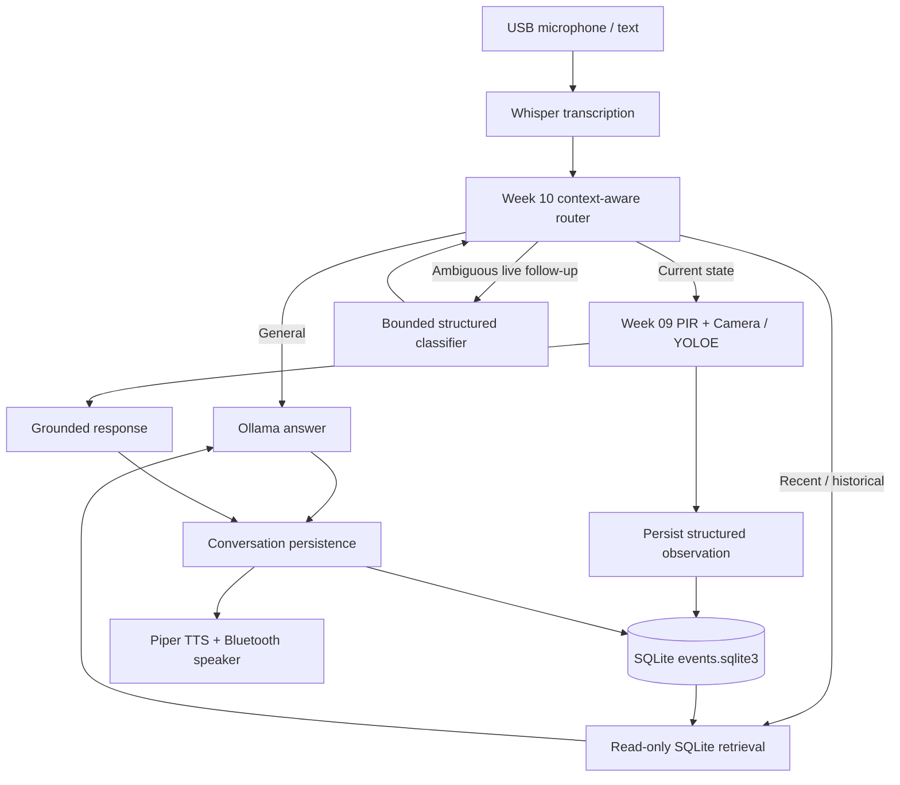

# Week 10 — Give the Pi memory

> Raspberry Pi 5 · PIR motion · Camera Module 3 · YOLOE · SQLite · Ollama · Whisper / Piper

**Goal:** One offline, voice-operated assistant that can answer general questions, check the physical scene on request, and recall previously recorded **environmental observations** and **conversations** after a restart.

This week extends the Week 09 assistant. It does not build a second audio stack or require embeddings, a vector database, fine-tuning, or multiple autonomous LLM agents.

## Architecture



The intent router is a **workflow router**, not a multi-agent supervisor. Python enforces the high-stakes sensor policy for occupancy questions. The camera and PIR are separate sources: motion is *not* a person detection, and a one-frame positive detection is *not* identification.

## Project files

| File | Responsibility |
| --- | --- |
| `voice_assistant.py` | Week 09 push-to-talk I/O with the Week 10 agent |
| `agent.py` | Routing, bounded follow-up clarification, live tools, responses |
| `followup_router.py` | Structured model classification for ambiguous live follow-ups |
| `conversation_store.py` | Persisted conversation sessions and turns |
| `memory_store.py` | SQLite event and Away Mode storage |
| `memory_tools.py` | History summaries and structured evidence retrieval |
| `recent_memory.py` | Recent-observation report (small existing helper) |
| `live_memory.py` | Persist live camera observations from voice requests |
| `event_monitor.py` | PIR-triggered captures during Away Mode |
| `benchmark.py`, `routing_cases.json` | Repeatable routing and latency-log evaluation |
| `tests/` | Regression tests, including benchmark tests |

`outputs/week_10/events.sqlite3` contains `away_sessions`, `observations`, `conversation_sessions`, and `conversation_turns`. UTC timestamps are stored, with Melbourne local-time conversions for reporting. Images are saved under `outputs/observations/` and referenced by database path.

**Do not commit** SQLite files, microphone recordings, captures, personal transcripts or benchmark logs that include spoken content. Check `git status` before pushing.

## Prerequisites

Start from `~/ollama_python` on the Pi, with the camera and PIR connected as in Weeks 06–09, the Week 09 audio components installed, and the separate vision environment present.

- Pi: Raspberry Pi 5 (8 GB), Camera Module 3, PIR on BCM GPIO23.
- Ollama model: `gemma4:e2b` by default (override via `OLLAMA_MODEL`).
- Week 09 interpreter: `src/week_09/.venv/bin/python`.
- Week 06 interpreter for monitoring: `src/week_06/.venv/bin/python` with `GPIOZERO_PIN_FACTORY=lgpio`.
- Vision worker: reused through Week 09 `PhysicalTools`; no parallel inference pipeline.

For recording/transcription/speech setup see [`../week_09/README.md`](../week_09/README.md). For YOLOE detection methodology see [`../week_07_08/README.md`](../week_07_08/README.md).

## Run the voice assistant

```bash
cd ~/ollama_python
src/week_09/.venv/bin/python src/week_10/voice_assistant.py \
  --mic-device plughw:0,0 --duration 5 \
  --output-dir src/week_10/outputs
```

Press Enter to record a question; `q` exits. To resume the latest stored conversation instead of starting a new session:

```bash
src/week_09/.venv/bin/python src/week_10/voice_assistant.py \
  --resume-last --mic-device plughw:0,0 --duration 5 \
  --output-dir src/week_10/outputs
```

`--session-id <conversation_session_id>` resumes a specific prior chat; it cannot be combined with `--resume-last`.

Examples of intent and evidence:

| User question | Intended path | Important boundary |
| --- | --- | --- |
| “What is 2 + 17?” | General | No camera or database retrieval needed |
| “Do you see anyone in the room?” | Live | Attempt both PIR and camera; PIR LOW doesn't skip the camera |
| “How about now?” after a live question | Contextual follow-up | New capture only if follow-up classifier requests it |
| “What did you see most recently?” | Recent memory | Previous *saved* camera/sensor observations; no capture |
| “Was anyone near my desk while I was away?” | History | Earlier saved events, with uncertainty |
| “Explain that earlier observation.” | Structured evidence **after Stage 1 repair** | Do not use assistant prose as physical-world ground truth; verify the local agent code has the repair |
| “What did we discuss last time?” | Conversation history | Previous saved text, not camera memory |

Live questions initiated through voice can also produce `trigger=live_observation` SQLite records. The environmental monitor uses `trigger=pir_motion`. Conversation sessions and Away Mode sessions are separate concepts.

## Run Away Mode

Terminal A (start a monitoring session):

```bash
PYTHONPATH=src/week_10 python3 - <<'PY'
from memory_store import arm_away_mode
print('Armed Away Mode session:', arm_away_mode())
PY
```

Terminal B (monitor):

```bash
export GPIOZERO_PIN_FACTORY=lgpio
PYTHONPATH=src/week_10 src/week_06/.venv/bin/python src/week_10/event_monitor.py
```

Allow the 60-second PIR settling period. To stop, press Ctrl+C in Terminal B. Then **disarm** in Terminal A:

```bash
PYTHONPATH=src/week_10 python3 - <<'PY'
from memory_store import disarm_away_mode
print(disarm_away_mode())
PY
```

Do not run independent camera observers simultaneously for these experiments. The monitor is synchronous and may miss brief PIR changes while YOLOE processes a frame. It is a learning prototype, not a security-grade surveillance system.

## Verify tests

```bash
cd ~/ollama_python
PYTHONPATH=src/week_10 src/week_09/.venv/bin/python \
  -m unittest discover -s src/week_10/tests -v
```

A failed literal-language assertion is different from a failure to retrieve evidence, use the correct tools or preserve memory. Prefer assertions on observable state and tool calls, not exact words.

## Benchmark the router and voice logs

The new **28-case routing suite** tests independent general questions, current-state requests, event memory, earlier conversations, and follow-ups. It evaluates the *first-stage deterministic router* without invoking the camera or model. A `live_followup` requires an additional structured classifier and is deliberately counted as a separate route, not proof of correct final intent.

```bash
PYTHONPATH=src/week_10 src/week_09/.venv/bin/python \
  src/week_10/benchmark.py --routes \
  --output outputs/week_10/routing_benchmark.json
```

Use `--strict` when you want any mismatch to cause exit code 1. An ordinary run reports mismatches and exits successfully so it remains useful for diagnosis. Two cases explicitly test unrelated questions immediately after a live question. The present router may classify them as `live_followup`, costing an extra model classification. **Do not claim 100% routing accuracy unless the measured run supports it.**

To capture a reproducible text/voice trace (may contain private transcripts):

```bash
mkdir -p outputs/week_10
PYTHONUNBUFFERED=1 src/week_09/.venv/bin/python \
  src/week_10/voice_assistant.py --mic-device plughw:0,0 \
  --duration 5 --output-dir src/week_10/outputs \
  2>&1 | tee outputs/week_10/voice_run.log

python3 src/week_10/benchmark.py \
  --log outputs/week_10/voice_run.log \
  --output outputs/week_10/voice_benchmark.json
```

The log analysis reports question count, route mix, physical-tool call counts and median/p95/max **agent time** from `[total_s]`. It does not pretend that this is full speech-to-speech time. For end-to-end timing use the voice assistant's own `[timings]` record: recording + STT + agent + TTS + playback. For evidence correctness, inspect event IDs/scores and actual captured frames; raw YOLO confidence is not calibrated occupancy probability.

### Reproducible final smoke experiment

1. Start a fresh conversation. Ask a general arithmetic question. Expect no physical tools.
2. Ask whether anyone is in the room. Expect `detect_motion` **and** `observe_scene`, even if PIR is LOW; save a live observation.
3. Ask “How about now?”. Expect the classifier to interpret the live context and, if it is a recheck, attempt another capture.
4. Ask “What did you see most recently?”. Expect SQLite retrieval, not another camera call.
5. Ask about the earlier detection confidence. Expect stored values and explicit uncertainty, not fabricated identity claims.
6. Quit, restart with `--resume-last`, and ask what you discussed. Verify persistence without rerecording the conversation.
7. Run the complete regression suite and the routing benchmark. Record failing test names and rerun after any changes.

### Recorded results — 19 October 2026

These are **previously observed Pi logs**, not measurements made by this documentation change:

| Experiment | Observation |
| --- | --- |
| Away Mode session 2 | 11 PIR-triggered events; four person-positive, seven person-negative, zero reported camera failures |
| Positive detection scores | 0.667, 0.862, 0.889, 0.466 (not calibrated probabilities) |
| Recent-observation voice question | 3.684 s LLM/agent stage, 25.659 s total including recording and playback |
| Room-presence voice question | 9.149 s agent stage, 30.256 s total; camera reported one person (score 0.536) while PIR reported no motion |

The model's initial load has sometimes taken around 55 seconds; it is not included in individual warm-turn `total_s` fields. The final benchmark values should be populated from an actual run, not inferred from these examples.

## Source-alignment check before final commit

The public `main` snapshot inspected for this documentation still had an older `_discuss_live_observation()` method referring to `assistant_text`. If you applied the Stage 1 repair locally, verify it appears in your current `git diff`/next push. **Do not mark the structured-evidence test complete until that implementation and its tests pass on the Pi.** The documentation package does not overwrite existing production modules.

## Remaining limitations / deliberate non-goals

- Structured SQLite is appropriate for timestamped events; embeddings/semantic search are deferred.
- More than one observation may refer to the same person. Negative detections don't prove absence.
- Camera and PIR check different things and can disagree without either failing.
- Away Mode indicates monitoring was armed, **not** verified human absence.
- A general question after a live question may still require a follow-up classifier decision; benchmark this overhead before adding new heuristics.
- The separate destructive session-deletion utility should eventually be moved out of normal `memory_tools.py` into an opt-in maintenance command. Do not invoke it in the voice agent.
- `memory_store.connect()` still checks/creates its tables for each connection; a dedicated startup migration would be cleaner, but is not necessary for the observed workload.
- The assistant is not intended to identify or track people across frames.

## Week takeaway

A short LLM context is not the same thing as persistent memory. Here the Pi stores **observations** and **dialogue** independently, retrieves the relevant evidence on demand, uses constrained workflows for physical checks, and leaves general chat free of unnecessary sensor actions.
