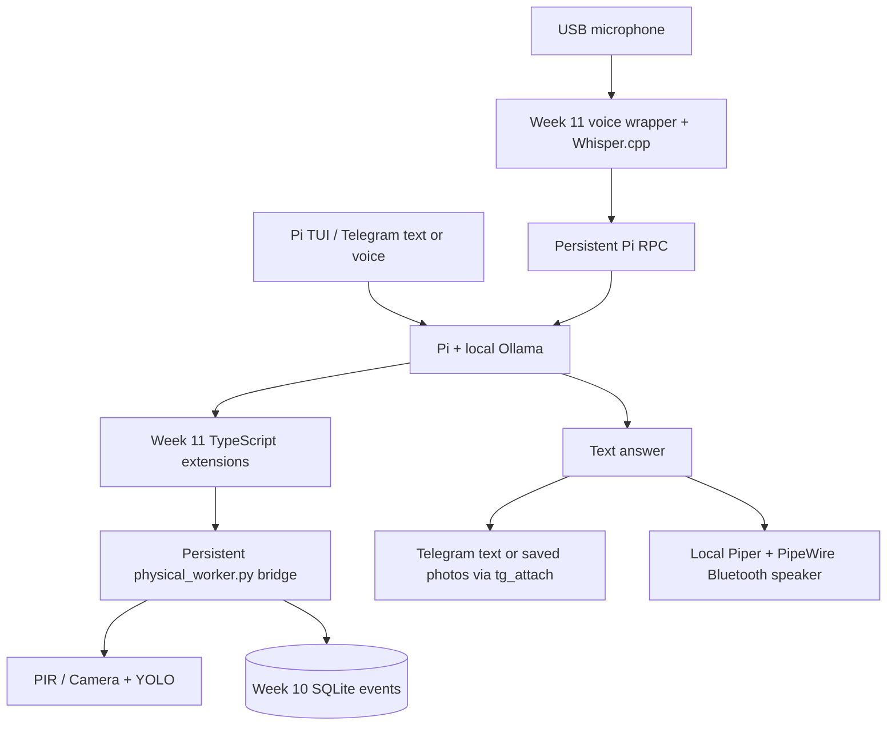

# Week 11 README insertion preview


<!-- BEGIN WEEK11_CONSOLIDATED_RUNBOOK -->
## Week 11 — Consolidated runbook

> **Final working setup and observed results, 22 October 2026.** This section consolidates the Week 11 experiments. Where an older command or provisional note farther down conflicts with this section, prefer this section. Week 10 stays unchanged as the historical benchmark baseline. All commands below run **on the Raspberry Pi**, unless explicitly identified as Mac commands.

### Objective and what Pi replaced

We delegated the model-facing agent loop, tool choice, multi-turn conversation and session handling from our previous Python agent to the Pi runtime. Pi does **not** replace our hardware access, sensor validation, YOLO detection, SQLite evidence storage, Whisper transcription or Piper synthesis. The project-local Pi extensions are the adaptation layer—not a rewritten sensor stack.



**Important:** the TUI/Telegram Pi session and the Python voice/RPC Pi session are different live processes/conversation sessions. They share saved SQLite observations, **not necessarily conversation turns**. Running both simultaneously is possible but avoid competing camera users during repeatable tests.

### Preconditions and project layout

```bash
cd ~/ollama_python
command -v pi
command -v ollama
ollama list
ollama show gemma4:e2b-8k
ollama ps
ls src/week_11/.pi/extensions/
ls -lh src/week_09/voices/en_US-lessac-medium.onnx*
ls -lh outputs/week_10/events.sqlite3
```

- Hardware used: Raspberry Pi 5 (8 GB), Pi Camera Module 3 on CAM/DISP 0, PIR sensor, USB microphone (`plughw:0,0`), Bluetooth Tribit XSound Go; Week 09/10 virtual environments and model files are prerequisites.
- Pi uses `~/.pi/agent/models.json` to register local Ollama models. The provider's OpenAI-compatible base URL is `http://localhost:11434/v1` with API type `openai-completions`; the active model is `ollama/gemma4:e2b-8k`. Preserve your existing configuration and use `/models` to verify registration. `qwen3.5:4b`, `gemma4:e2b` and `gemma4:e4b` were also explored; the exact installed model IDs matter.

**First-time Pi/Telegram installation only** (don't reinstall an already working integration):

```bash
# Official Pi installer, for a fresh Raspberry Pi installation:
curl -fsSL https://pi.dev/install.sh | sh
pi --version
node --version               # pi-telegram-plus requires Node.js >=22.19
pi install npm:pi-telegram-plus
pi list                       # confirm the package is present
```

Review package source and version compatibility before installing or upgrading third-party extensions. Official references: [Pi quickstart](https://pi.dev/docs/latest/quickstart), [Pi compatible Ollama endpoints](https://pi.dev/docs/latest/models), [pi-telegram-plus](https://pi.dev/packages/pi-telegram-plus). For a fresh local Ollama provider, **merge** (do not replace the whole file) this reference entry into `~/.pi/agent/models.json`:

```json
{
  "providers": {
    "ollama": {
      "baseUrl": "http://localhost:11434/v1",
      "api": "openai-completions",
      "apiKey": "ollama",
      "models": [{"id": "gemma4:e2b-8k"}]
    }
  }
}
```

`apiKey: "ollama"` is a dummy local-server key used by Pi to recognize the provider, not a cloud secret. With Pi TUI running, select `/model` or `/models` (depending on the installed Pi version) and verify the Ollama model ID is offered. Actual registration may need additional model metadata on older Pi versions; preserve a known-working configuration rather than replacing it with this illustrative snippet.
- Check dependencies before troubleshooting Telegram audio: `command -v ffmpeg; command -v ffprobe`, the Week 09 Whisper executable and `ggml-tiny.en.bin` model. Telegram needs the installed/configured `pi-telegram-plus` extension; see that plugin's own configuration instructions. Do **not** commit bot tokens, user IDs, Pi credentials or authorization links.
- Useful paths: `src/week_11/.pi/extensions/` (Pi hooks/tools), `src/week_11/physical_worker.py` (Python sensor bridge), `src/week_11/pi_rpc.py` (Pi JSONL client), `src/week_11/voice_assistant.py` (audio wrapper), `src/week_11/voice_system.md` (compact policy), `src/week_11/local_speaker.py` (Bluetooth TTS), `src/week_11/telegram_stt.py` (voice-note STT), `src/week_11/memory_event_index.py` (historical evidence lookup). Generated images live under `outputs/observations/`; SQLite lives under `outputs/week_10/`.

### Start Pi in local/Telegram TUI mode

```bash
cd ~/ollama_python/src/week_11
pi --model ollama/gemma4:e2b-8k \
  --system-prompt "$PWD/voice_system.md" \
  --no-context-files \
  --tools detect_motion,observe_scene,check_presence,query_memory,tg_attach \
  --no-mcp --tui-mode regular
```

This is the **restricted environment-assistant profile**. Starting Pi in `src/week_11/` ensures project-local `.pi/extensions` load. If your Telegram plugin is disabled or absent, `tg_attach` won't be available. In an interactive TUI, `/sensor-health` should say `Python sensor bridge: ready`—this only tests the bridge, **not** the camera, PIR or Ollama. Try `/models` to confirm the local model.

**For software development:** start Pi with your usual coding tools and let it read `AGENTS.md`. The restricted profile deliberately uses `--no-context-files` so `voice_system.md` is the primary, compact instruction set for a small local model. It does **not** disable `.pi/extensions`. `--no-mcp` disables unrelated MCP integrations and `--tools` limits model-visible tools; neither is a claim of OS-level isolation. We used `--no-tools --no-extensions --no-context-files --no-mcp` only for arithmetic ablation; that configuration cannot use sensors or memory.

**Native tools and examples** (ask in the TUI or Telegram):

| User request | Expected operation | Interpretation |
| --- | --- | --- |
| `What is 2 + 17?` | No tool | Quick routing/inference smoke test; expected `19` |
| `Is there anyone in the room right now?` | `check_presence` | Live PIR + fresh camera evidence, not proof of occupancy |
| `Has motion been detected?` | `detect_motion` | Current PIR signal alone does not identify a person |
| `What objects can you see?` | `observe_scene` | Fresh camera + YOLO; specify relevant labels if needed |
| `How many person-positive events are saved?` | `query_memory(operation="summary")` | Historical SQLite aggregate; no fresh camera capture |
| `What was your most recent observation?` | `query_memory(operation="recent")` | Stored observations, not a live check |
| `Show person-positive events with score above 0.7` | `query_memory(operation="events", min_score=0.7)` | Filter historical model scores, not calibrated confidence |
| `Show the images for events 23 and 22` | `query_memory(...event_ids=[23,22])` then `tg_attach` | Only actual `evidence_path` returned by SQLite is valid |

Memory operations include `recent`, `summary`, `away`, `events` and `event`. The event-search extension supports `min_score` and exact `event_ids`, returning `evidence_path` and `image_available` for saved images. Ask for IDs/scores first when requesting multiple historical images; the agent must never fabricate a guessed image path. `query_memory` is a read-only historical lookup; live checks can create new observation records.

### Text-only and persistent Pi RPC tests

For a single RPC turn (no Whisper/Piper):

```bash
cd ~/ollama_python
python3 src/week_11/pi_rpc.py --no-session \
  --system-prompt src/week_11/voice_system.md --no-context-files \
  --prompt 'What is 2 + 17?'
```

For a persistent conversation and tool trace:

```bash
python3 src/week_11/pi_rpc.py --no-session \
  --system-prompt src/week_11/voice_system.md --no-context-files
```

Enter questions one at a time; type `q` to quit. The `[pi_rpc]` line shows elapsed time, selected tools, tool durations and token counters. `--no-session` means no saved Pi session, **not** that prompts cannot share context within that one running process. Prefer the persistent process to restarting Pi for every prompt.

### Offline microphone-to-speaker path

**Text smoke test** (skips microphone and sound playback but still synthesizes a reply WAV):

```bash
cd ~/ollama_python
src/week_09/.venv/bin/python src/week_11/voice_assistant.py \
  --pi-model ollama/gemma4:e2b-8k --pi-no-context-files \
  --text 'What is 2 + 17?' --no-play
```

**Microphone interaction** (5-second ALSA capture, Whisper → Pi RPC → Piper → Bluetooth):

```bash
src/week_09/.venv/bin/python src/week_11/voice_assistant.py \
  --pi-model ollama/gemma4:e2b-8k --pi-no-context-files \
  --mic-device plughw:0,0 --duration 5
```

Keep the process open; press Enter to record and `q` to quit. The audio wrapper reports per-stage timing (`record_s`, `stt_s`, `llm_s`, `tts_s`, `play_s`, `total_s`), while the Pi RPC trace reports tool decisions. `--pi-continue` resumes the most recent **Pi** session for this project; it does not import the Week 10 Python conversation. `--pi-system-prompt` can override the compact prompt; `--pi-no-context-files` disables automatic loading of `AGENTS.md`/`CLAUDE.md`. The Week 11 CLI parses its own `--pi-*` flags and forwards shared audio flags to the Week 09 parser, so `week_11/voice_assistant.py --help` may misleadingly show only Week 09's help.

### Telegram: text, voice input and saved images

The installed `pi-telegram-plus` extension connects the running Pi session to your authorized Telegram account. Telegram input/output is **text/images**: we transcribe incoming voice notes **locally** but do not send Piper audio or voice replies back to Telegram. For first-time pairing (inside Pi TUI), use `/tg-bot-add` to add a BotFather-created bot, then `/tg-cwd-connect` or `/tg-bind-cwd` to bind it to the project; `/tg-list` displays the current binding. These are `pi-telegram-plus` commands, not shell commands. Follow the installed plugin's onboarding flow and approve **only your own Telegram account**. Store credentials privately; never copy the bot token into the README, commit or chat log.

- Telegram **text**: send any normal question; the agent uses its normal Pi tools.
- Telegram **voice**: a `.oga` attachment is downloaded into the project folder, validated, converted using `ffmpeg` to a 16-kHz mono PCM WAV, transcribed with our existing Week 09 Whisper implementation, then supplied as text to Pi. Verify `ffmpeg`, `ffprobe`, the Whisper CLI binary and its model. The source filter in `telegram_voice.ts` was removed after discovering Telegram messages were labeled `event.source="interactive"`, not `"extension"`; restoring that filter silently disables transcription. Failed transcription should not expose arbitrary file paths to the LLM.
- **Live photo:** ask for a fresh scene and to send the corresponding stored observation image. **Historical photos:** ask for event IDs via `query_memory(operation="events",...)` and attach the returned absolute `evidence_path` with `tg_attach`. A path such as `/tmp/image.jpg` or a made-up event directory must never be treated as saved evidence.

**Attachment guard (tested):** `.pi/extensions/telegram_attachment_guard.ts` blocks model-invoked `tg_attach` unless all requested files are existing, canonical `scene.jpg`, `annotated.jpg`, `scene.png` or `annotated.png` under `outputs/observations/`; accepts up to ten per call. Symlinks escaping that directory and mixed valid/invalid batches are rejected. This is a **tool-specific guard**, not a universal filesystem sandbox. The private Telegram bot still needs a narrow account allowlist.

```bash
cd ~/ollama_python
node --test src/week_11/tests/test_telegram_attachment_policy.mjs
# Positive test in Telegram: 'Send the saved scene image for event 23.'
# Negative test: ask Pi to call tg_attach with paths=["/tmp/week11_guard_test.jpg"]
# (Create /tmp/week11_guard_test.jpg as a copy of an actual scene.jpg first.)
```

A successful negative test requires an **attempted tool call that gets blocked**, not merely a model refusing to invoke `tg_attach`. The user verified live and historical image delivery and the guard in Week 11. Never publish raw Telegram downloads, tokens, chat IDs, or private saved photographs in Git.

### Local Bluetooth speaker, Piper, and why Telegram currently stays silent

In normal Pi TUI mode, `.pi/extensions/local_speaker.ts` captures completed assistant text and calls `local_speaker.py` to run **Week 09's `python -m piper`**, then `pw-play` to the **default PipeWire Bluetooth sink**. RPC-mode audio is already handled in `voice_assistant.py`, so the extension skips RPC to prevent duplicate playback.

The default voice model is `src/week_09/voices/en_US-lessac-medium.onnx`. You don't need audio environment variables with the finalized helper. `PI_SPEAKER_MODEL` optionally overrides its path; `PI_SPEAKER_PIPER` optionally supplies a **standalone** Piper binary; `PI_SPEAKER_PLAYER` optionally overrides `pw-play`. We used `unset PI_SPEAKER_PIPER` because Week 09 works with the Python-module version, and an outdated standalone-executable override prevented synthesis.

```bash
cd ~/ollama_python
wpctl status
wpctl inspect @DEFAULT_AUDIO_SINK@
# If needed: wpctl set-default <BLUETOOTH_SINK_ID>
wpctl set-volume @DEFAULT_AUDIO_SINK@ 0.50
unset PI_SPEAKER_MODEL PI_SPEAKER_PIPER
src/week_09/.venv/bin/python src/week_11/local_speaker.py \
  'Hello, this is a local Bluetooth speaker test.'
# If TTS works but you hear nothing, try an existing WAV:
# pw-play /absolute/path/to/existing_reply.wav
```

Expected helper result: `spoken: Bluetooth speaker` if the speaker is the **default** sink; otherwise it deliberately skips speech. A former warning, `Set PI_SPEAKER_MODEL ...`, was resolved by making the Week 09 `.onnx` file the default. If you override an environment variable, it must be set **before starting Pi**, because child processes inherit the parent Pi environment. Use the correct voice path under `src/week_09/voices/`; searching only under `~/opt` can miss it.

**Observed behaviour:** typed local TUI responses played on Bluetooth, while Telegram text/voice messages produced Telegram text without local speech. This difference is **not enforced by an origin-based guard**: the Telegram integration can forward messages as `interactive`. A future update could change this behaviour. For guaranteed remote silence, isolate Telegram and local use into separately configured Pi processes/extensions or add a supported origin signal. Do not rely solely on `event.source` for security.

### Verification tests

```bash
cd ~/ollama_python
python3 -m unittest discover -s src/week_11/tests -p 'test_pi_rpc.py' -v
src/week_09/.venv/bin/python -m unittest discover -s src/week_11/tests -p 'test_local_speaker.py' -v
src/week_09/.venv/bin/python -m unittest discover -s src/week_11/tests -p 'test_telegram_stt.py' -v
node --test src/week_11/tests/test_telegram_attachment_policy.mjs
```

Older patches also supplied memory/bridge tests (`test_memory_event_index.py`, `test_query_memory.py`); use whichever test modules are present in the checked-out tree. The real Pi requires connected camera/sensor hardware for live integration tests, and tests may need the appropriate Week 09/vision virtual environments. Run one Pi process at a time for clean benchmarks.

### Week 10 versus Week 11: measurements and what we learned

**Experiment:** Raspberry Pi 5 (8 GB), same `gemma4:e2b-8k` model, three repeated warm requests after one warm-up *per backend/task*, text inputs and `--no-play` (Piper still synthesizes output WAV). The one-shot harness restarted the subprocess for every request; therefore its warm results meant **Ollama-warm**, not a persistent Pi session. These figures are a dated, local experimental snapshot, not general Pi performance guarantees.

| Task | Week 10 warm median `llm_s` | Week 11 Pi warm median `llm_s` | Interpretation |
| --- | ---: | ---: | --- |
| Arithmetic (`2+17`) | 1.089 s | **0.508 s** | Pi faster in the agent stage, but slower in process wall time |
| Positive event count | 1.600 s | **50.352 s** | **Not comparable as successful queries:** Week 10 wrongly selected `[route] general` and claimed there were no observations; Pi fetched 14 through SQLite |
| Last positive detection | 2.405 s | **55.750 s** | **Not comparable as successful queries:** Week 10 said it had no readings; Pi used stored history |
| Live presence | **7.269 s** | 25.132 s | Both gave cautious grounded answers; Pi ~3.5× slower |

The ground-truth positive count **14** and timestamp **2026-10-21 19:10:23 AEDT** belonged to the benchmark database state of 22 October 2026; **do not hard-code these as current memory facts**. Week 10 remains unmodified as the historical baseline. The observed `[route] general` failure illustrates **fragility of our particular explicit keyword/intent-routing coverage**, not proof that every routing-based architecture is inherently bad. A fast incorrect answer is not a successful latency measurement.

Tool timing made the bottleneck clear: Pi's 50.369-second successful count included just **0.049 seconds** in `query_memory`; the database was not the bottleneck. A live presence trace selected `check_presence`, `detect_motion`, `observe_scene`; some measurements may overlap or be nested, so don't add per-tool durations blindly or assert duplicate camera capture without checking code.

**Persistent Pi RPC exploratory sequence:** first arithmetic **94.704 s** (1,328 input tokens); first correct count **49.762 s** (1,423 input tokens); last person detection **12.743 s**; repeated count **2.106 s** with **no tool call**. Later replies can benefit from context/cache reuse but may be **stale** unless rechecked against SQLite. E.g. a subsequent person-negative count of 29 was given without `query_memory` and was **not verified**. For independent factual questions, inspect the selected tools; a plausible answer is not evidence of a fresh lookup.

**Benchmark harness gotchas:**

1. The first version used `Path.resolve()` on `src/week_09/.venv/bin/python`, following the symlink to `/usr/bin/python3.13`, causing immediate import errors. Preserve the venv executable path (use `.absolute()`, not `.resolve()`).
2. A second preflight expected Week 11 `--pi-*` flags in `--help` but Week 11 forwards help to Week 09. Check Week 11's wrapper parsing explicitly instead.
3. Alternating Week 10/11 runs produced large transition costs; blocked warm-up sequences give a clearer within-backend estimate, but **still restart processes**.
4. Distinguish `llm_s` (model + tools), `total_s` (selected audio pipeline stages) and process `wall_s` (startup/teardown too). For example, Week 10 initially spent >50 s outside `total_s` during model startup. Cold loads and first prompt processing must be reported separately.
5. The most recently named `benchmark_*` folder is **not necessarily the one containing each task**. Find exact log paths with `find outputs/week_11 -name 'positive_count_*_r01.log'`; never assume `LATEST` includes every workload.
6. `review` is **not always failure**: `last_positive` and `presence` were deliberately manual-review tasks; `positive_count` was `review` for Week 10 because the actual answer was incorrect. Inspect `[route]`, `[assistant]`, `[pi_rpc]` and SQLite truth before interpreting speed.

If retaining the local benchmark helper in your home directory (not automatically part of Git):

```bash
cd ~/ollama_python
python3 ~/week10_week11_benchmark_v4_blocked.py \
  --tasks arithmetic --runs 3 --warmups 1
# Choose other tasks explicitly when checking historical/sensor workloads.
find outputs/week_11 -path '*/logs/*.log' -name 'positive_count_*' -print
```

We deliberately **did not rewrite Week 10 routing** to improve these benchmark results; the failure itself is part of the engineering lesson. Further Pi optimization (prompt/tool-schema size, reliable fresh-history checks, persistent sessions and possible extra sensor work) is future work, not a blocker for completing Week 11.

### Troubleshooting / gotchas checklist

| Symptom | Cause or next check |
| --- | --- |
| Pi can't use hardware tools | Launch from `src/week_11`, check `.pi/extensions/environment.ts`, `--tools` allowlist and `/sensor-health`; tools disabled in `--no-tools` ablations |
| `/models` can't find local Gemma | Edit/check `~/.pi/agent/models.json`; base URL `/v1`, provider `openai-completions`, exact ID; Ollama daemon/model must exist |
| `Invalid authorize request` in cloud/tunnel setup | Pi cloud authentication is separate from local Ollama; no cloud tunnel needed for the local-agent workflow |
| Thinking/compaction/truncation, arithmetic regressions | Small model context and tool-heavy instructions; prefer compact `voice_system.md`, `--no-context-files`, narrow tool list; don't assume every local Gemma variant accepts `thinking off` |
| `AGENTS.md` seems ignored | Deliberate for embedded runtime with `--no-context-files`; omit the flag when using Pi for repository development |
| Can't copy text from Pi TUI | Regular terminal mode restored copying where enhanced mode interfered: `--tui-mode regular` |
| Telegram `.oga` arrives but isn't transcribed | `telegram_voice.ts` must not reject `source="interactive"`; check `ffmpeg`, `ffprobe`, Whisper binary/model and input path validity |
| Telegram image isn't sent | `tg_attach` needs exact absolute saved `evidence_path`, allowed filename and `outputs/observations` root; guard blocks anything else |
| Speaker plays from helper but not Pi | Restart Pi after changing environment/model; check default BlueZ sink, `PI_SPEAKER_MODEL` (default Week 09 `.onnx`), unset stale `PI_SPEAKER_PIPER` |
| TUI speaks but Telegram silent | Observed, acceptable remote use; **not** a guaranteed source-based routing policy |
| Camera query slower after startup | Capture/YOLO worker warm-up and possible nested sensor operations; check `tool_s` before attributing latency to the model |
| Pi answers memory rapidly with no tool | Could be a cached conversational answer; verify whether a fresh `query_memory` call was actually made |
| Prior patch won't apply | Earlier patch anchors may differ from your checkout; use `git apply --check` before applying, don't blindly force it |

### Privacy, housekeeping and close-out

Keep `outputs/` artifacts, SQLite, saved photographs, Telegram downloads, voice WAVs, chat sessions, authorization secrets and temporary patches out of Git. Review `git status --short` and `.gitignore` before committing; do not commit `~/.pi/agent/models.json` if it contains account/provider secrets. Sensor detections remain **unverified model predictions**; lack of detection does not prove an empty room, a person ID or absence of risk. Event scores are not calibrated probabilities.

Week 11 is complete at the **functional** level. The decision was to keep Pi for reduced orchestration and extension flexibility, preserve Week 10 as the baseline, and document Pi's significant first-request/tool-heavy latency rather than conceal or prematurely optimize it.
<!-- END WEEK11_CONSOLIDATED_RUNBOOK -->
