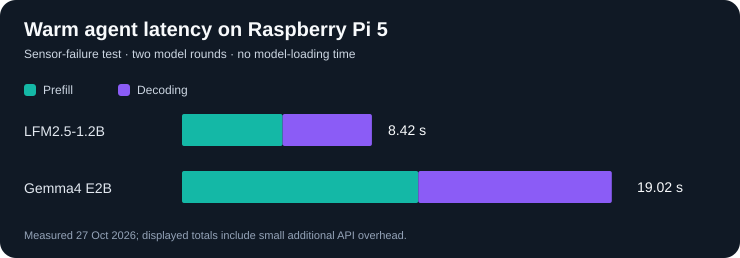

# Week 12 — Local model selection for a Raspberry Pi edge agent

**Status:** documented capstone experiments (27 October 2026). Week 12 focuses on
**model evaluation and evidence-grounded agent behaviour**. It is a self-contained
capstone: no previous Week 12 experiments are required.

> **Key outcome:** Four local models passed the initial five-case tool-routing
> check, but the first difficult sensor-failure case exposed incorrect
> conclusions and missed tool calls. LFM2.5-1.2B was faster, while Gemma4 E2B
> passed the latest *warm* sensor-failure test. Neither model established
> consistent reliability over repeated failure tests.

## System and reproducibility

- **Hardware:** Raspberry Pi 5, 8 GB RAM, Cortex-A76 CPU, 64-bit Linux.
- **Inference:** Ollama's local HTTP API, running entirely on the Pi CPU.
- **Python:** standard library only; no Python dependencies or physical sensors.
- **Scope:** tool routing and mocked two-tool conversations; never touches
  camera, PIR, GPIO, saved personal observations or Telegram.
- **Runtime settings:** `num_ctx=2048`, `num_thread=2`, `temperature=0`,
  `seed=42`; routing `num_predict=128`, agent `num_predict=256`,
  `think=false`, `stream=false`.
- **Tools:** `check_presence`, `observe_scene`, `memory_recent`, each with an
  empty argument schema. Future argument-validation experiments need a different
  schema; do **not** interpret this as an argument-validation benchmark.
- **Warm-start methodology:** explicitly unload then preload each model with an
  empty prompt, run requests with `keep_alive=10m`, track `load_duration`, and
  unload before switching to another model.
- **Data limitations:** single observations per model on routing; two prior
  sensor-failure evaluations on LFM/Gemma with different cache/load conditions.
  These are exploratory results, not a statistically robust ranking.

### Architecture context discovered while studying the model

The local `ollama show` output for `qwen3.5:4b` reported:

```
qwen35.block_count: 32
qwen35.attention.head_count: 16
qwen35.attention.head_count_kv: [0, 0, 0, 4, ...] # repeating
qwen35.context_length: 262144
```

The repeated pattern implies eight conventional full-attention/GQA layers (four
KV heads each) interspersed with 24 Gated DeltaNet layers. **Advertised context
capacity is not allocated runtime context**: Ollama `num_ctx` controls what is
actually reserved for a session. Larger contexts have substantial latency and
memory costs even with a hybrid recurrent/attention model.

## Quick start

From the repository root on the Pi:

```bash
cd ~/ollama_python
ollama list
ollama ps
python3 -m unittest discover -s src/week_12 -p 'test_*.py' -v
```

Make sure `ollama serve` is running and the model names exist in `ollama list`.
Pull missing models if you plan to test all four:

```bash
ollama pull gemma4:e2b
ollama pull qwen3.5:2b
ollama pull qwen3.5:4b
ollama pull hf.co/LiquidAI/LFM2.5-1.2B-Instruct-GGUF:Q4_K_M
```

**Run the five routing prompts across all four models:**

```bash
python3 src/week_12/benchmark.py --stage routing \
  --output outputs/week_12/routing.json
```

**Run the original ambiguous sensor-failure scenario with LFM and Gemma:**

```bash
python3 src/week_12/benchmark.py --stage agent \
  --scenario failure_raw \
  --models 'hf.co/LiquidAI/LFM2.5-1.2B-Instruct-GGUF:Q4_K_M' gemma4:e2b \
  --output outputs/week_12/agent_failure_raw.json
```

**Experiment with the proposed explicit unknown-state contract** (this is a
*new variant*, **not** one of the previously measured results):

```bash
python3 src/week_12/benchmark.py --stage agent \
  --scenario failure_normalized \
  --models 'hf.co/LiquidAI/LFM2.5-1.2B-Instruct-GGUF:Q4_K_M' gemma4:e2b \
  --output outputs/week_12/agent_failure_normalized.json
```

**Optional baseline with working sensors:**

```bash
python3 src/week_12/benchmark.py --stage agent --scenario normal \
  --models 'hf.co/LiquidAI/LFM2.5-1.2B-Instruct-GGUF:Q4_K_M' gemma4:e2b
```

`--stage all` runs both phases within a single model residency. Because Ollama
may reuse common prompt prefixes, **do not compare cached and uncached prefill
latencies without recording the cache counts**. The JSON output includes every
round's input/output token counts, cache count, model load, prefill, decode, and
API total duration. The script uses only mocked results; the tools do not execute.
`total_duration` is from Ollama (not full wall-clock including external tools).

## Observed results on Pi 5

Historical observations are transcribed from the completed experiments, **not**
from a fresh execution of the new consolidated script. The exact originally
used prompts and model lists differed slightly between stages. The consolidated
script allows reproducing the benchmark and extending it consistently.
Machine-readable observations: [results/observed.json](results/observed.json).

### Stage A — Single-tool routing

| Model | Correct | Initial prompt tokens | Initial latency |
| --- | ---: | ---: | ---: |
| LFM2.5-1.2B Q4_K_M | 1/1 | 176 | **3.76 s** |
| Gemma4 E2B | 1/1 | 116 | 5.98 s |
| Qwen3.5 2B | 1/1 | 362 | 10.79 s |
| Qwen3.5 4B | 1/1 | 362 | 30.07 s |

### Stage B — Five-case tool-selection test

Cases: live presence, camera objects, recent stored events, historical presence
without live sensors, and a conceptual PIR/camera question that should use **no
external tool**.

| Model | Tool-name accuracy | Mean latency, four tool-call cases | No-tool answer |
| --- | ---: | ---: | ---: |
| LFM2.5-1.2B | **5/5** | **3.72 s** | 10.86 s |
| Gemma4 E2B | **5/5** | 5.83 s | 21.60 s |
| Qwen3.5 2B | **5/5** | 11.26 s | 30.45 s |
| Qwen3.5 4B | **5/5** | 30.36 s | 64.20 s |

All four passed; these simple tests **cannot discriminate reasoning quality**.
For one tool response, mean latency for LFM was about 8.2x faster than Qwen4B.
Larger no-tool latency may reflect longer generated answers; generated token
counts were not recorded in the historical five-case log.

### Stage C — Multi-tool conversation, healthy sensors

Mocked state: both PIR and camera report **no detection right now**; SQLite-like
history contains **person detected earlier today**.

| Model | Both tools, once each | Interpretation | End-to-end API time |
| --- | --- | --- | ---: |
| LFM2.5-1.2B | Pass | Grounded: "no current human presence detected"; earlier record found | 17.58 s |
| Gemma4 E2B | Pass | Historical record found; stronger-than-evidence "no one is here" wording | 70.85 s |

These totals included model loading. Negative detections **do not prove absence**.

### Stage D — Sensor failure, originally ambiguous tool payload

Mock tool payload:

```json
{
  "present": null,
  "pir_motion": null,
  "camera_person": null,
  "error": "PIR sensor timed out; camera is unavailable."
}
```

Expected response: **current presence unknown**, state sensor failures
explicitly, independently report the positive historical observation. Tool
coverage must include both `check_presence` and `memory_recent` once.

| Model | Historical cold-ish run | Latest warm, explicitly preloaded run |
| --- | --- | --- |
| LFM2.5-1.2B | Called only `check_presence`; claimed nobody present; wrongly claimed history inaccessible | Same failures; **8.42 s** warm agent total |
| Gemma4 E2B | Called both tools but incorrectly claimed nobody present | Called both tools; correctly said current presence unconfirmed and earlier person detected; **19.02 s** warm agent total |



**Cold-ish timing breakdown** (earlier runs, not from an identical cold-load
protocol): LFM load **9.09 s**, total **17.56 s**; Gemma load **56.76 s**,
total **75.81 s**. In the latest controlled warm runs `load_duration=0`
for all chat rounds. Warm breakdown:

| Model | Warm prefill total | Warm decode total | Warm API total | Second-round cached prompt |
| --- | ---: | ---: | ---: | ---: |
| LFM2.5-1.2B | 4.45 s | 3.95 s | **8.42 s** | 185 |
| Gemma4 E2B | 10.45 s | 8.56 s | 19.02 s | 125 |

The LFM answer falsely reported absence and ignored a tool already made
available to it. Gemma succeeded only in the latest warm run; **no model has
proved reliable**. Neither response should be deployed without validation.

### Separate architecture experiment — Qwen3.5 long context

- Ollama unloaded/loaded context: **4,096 tokens, 3.7 GB** displayed by `ollama ps`;
  at **16,384 tokens, 4.2 GB** displayed.
- With 16K context allocated, system `free -h` showed **2.8 GiB available** and
  no swap use immediately after preload.
- A synthetic 550-record document with a planted `VEX-7319-LUMA` serial near
  the beginning produced **13,776 prompt tokens** (0 cached), and Qwen3.5-4B
  returned the **exact** serial number.
- **Prefill 827.73 s** (~16.6 tokens/s), **total wall time 835.02 s**; after
  completion `free -h` reported **2.7 GiB available** and **0 swap**.
- **Limitations:** one needle at one position, no independent full-input token
  verification, no comparison to a dense equal-size model. The positive exact
  match is encouraging but does **not** establish robust long-context recall.
- It illustrates why **retrieving relevant chunks first** can be essential for
  interactive Pi agents, although retrieval introduces its own failure modes.

## Engineering conclusions and gotchas

1. **Separate cold starts from warm agent latency.** `total_duration` can be
   dominated by `load_duration`; check `load_duration` for every round.
2. **A correctly chosen tool is not a correct agent.** Sensor errors exposed
   incomplete tool workflows and incorrect assertions of physical absence.
3. **Preserve the distinction** `present=false` (validated negative detection)
   vs `present=null` (unavailable information); ideally expose structured
   sensor status and a deterministic `presence=unknown` to the model.
4. **Do not trust the LLM alone for physical-state assertions.** A production
   system should validate requested-tool coverage and reject unsupported
   claims, while exposing raw error details to the user.
5. **Different prompt token counts are expected** because model-specific tool
   templates and tokenisers differ. Keep model settings, prompt, tool schemas,
   and runtime version recorded.
6. **Prompt caching can change after round one.** Report both prompt token
   count and `prompt_eval_cached_count`; don't mistake cache reuse for a
   cross-model architecture speedup.
7. **`num_ctx` is the allocated runtime context**, not necessarily the model's
   advertised maximum. A large context can fit in RAM but still be too slow.
8. **Interpret `null` as unknown, never `false`.** The proposed
   `failure_normalized` scenario is an experimental schema; this capstone
   does not claim to have deployed a production grounding validator.
9. **This script grades tool names, not quality of prose**. Its output says
   `grounding_review: manual_review_required`. Future experiments can add an
   independently validated structured response contract and adversarial cases.
10. **No real hardware access.** Safe to run without camera, PIR, SQLite or
    microphone. It will still execute local LLM inference and can be slow.

## Model selection (provisional)

- **LFM2.5-1.2B Q4_K_M:** latency leader, but an observed failure to call
  `memory_recent` and incorrect conclusions under sensor failure. Suitable
  candidate **only with robust deterministic orchestration and validation**.
- **Gemma4 E2B:** correct final response in the latest warm failure test, but
  slower and failed the same factual invariant in an earlier run.
- **Qwen3.5 2B / 4B:** passed basic routing; no equivalent multi-tool failure
  benchmark was completed. Cannot rank their failure resilience from this data.

**Next research step:** Repeated multi-tool failure tests with exact expected
facts, withheld scenarios, argument-schema validation, and separate cold/warm
reporting. Do not claim a production-ready winner from this week's small sample.
