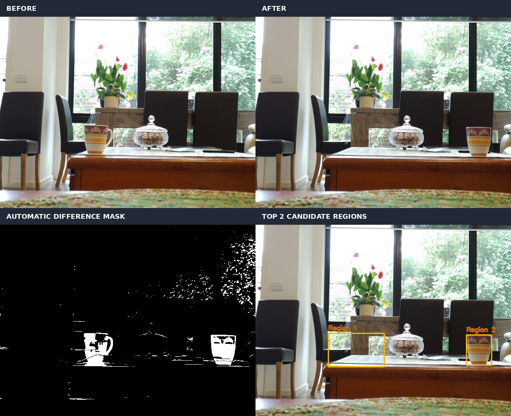
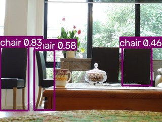
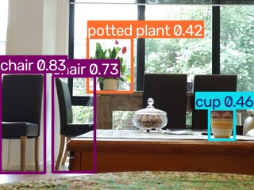
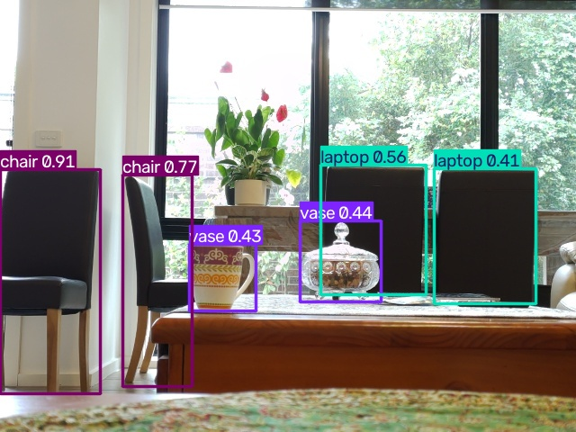
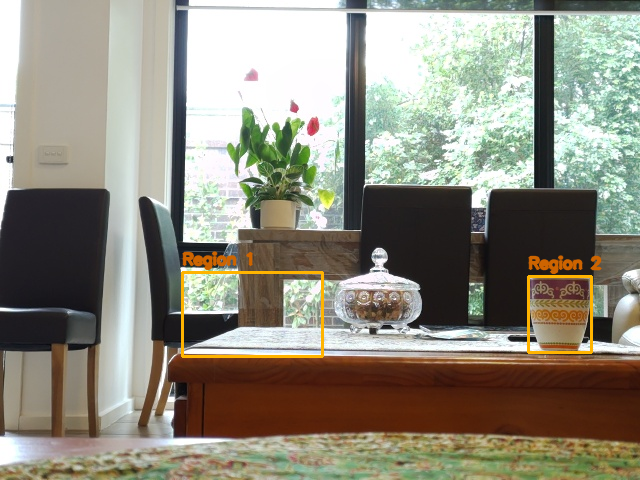

# Week 14 — Edge Vision, Multimodal Inference & Change Detection

**Status:** Module 6 **in progress**. This page documents the first vision/VLM/change-detection experiments completed on the Raspberry Pi 5 through **2 November 2026**. Change detection is intentionally **closed** for now; the rest of Module 6 (inference runtimes, streaming and end-to-end pipeline benchmarking) comes later.

> **Goal.** Measure what classical CV, a specialised detector, and a small local vision-language model can and cannot do on *the same actual scene*. Optimise based on evidence rather than assuming an LLM is the correct tool for every visual subtask.

## Contents

1. [Hardware, scene and hypotheses](#1-hardware-scene-and-hypotheses)
2. [What we tested](#2-what-we-tested)
3. [VLM inference: multi-image vs single-image](#3-vlm-inference-multi-image-vs-single-image)
4. [YOLO26n NCNN: detections and latency](#4-yolo26n-ncnn-detections-and-latency)
5. [Classical CV: pixel differences and automatic Otsu](#5-classical-cv-pixel-differences-and-automatic-otsu)
6. [Rerun and verify](#6-rerun-and-verify)
7. [Engineering lessons and gotchas](#7-engineering-lessons-and-gotchas)
8. [Remaining Module 6 roadmap](#8-remaining-module-6-roadmap)
9. [Dataset and artifacts](#9-dataset-and-artifacts)

## 1. Hardware, scene and hypotheses

**Device:** Raspberry Pi 5 Model B Rev 1.1, 8 GB RAM, Debian 13 aarch64; Pi Camera Module 3. Ollama hosts local VLMs; YOLO26n is run via exported NCNN models. This follows the earlier Week 07/08 YOLOv8n experiments but the model in these Week 14 detector outputs is **YOLO26n**, not YOLOv8n.

**Task:** From two fixed-view photographs of the same indoor scene, report what changed. The patterned **mug** moved from the **left** of the glass lidded bowl to the **right**. The bowl is stationary. Both input photos are **640 × 480**. Outside vegetation can move and ambient illumination can vary.

**Ground truth for this pilot (human inspection):** one mug changed location; the glass ornament did not. No detailed object masks, multiple trials, or calibrated ground truth annotations were collected. This is an exploratory engineering study, **not** a statistical comparison of model accuracy.

| Hypothesis / question | Outcome |
|---|---|
| Can a small local VLM correctly infer a move from two RGB images? | Sometimes, but not reliably on this pair; LFM3-VL at 320×240 mostly succeeded once, other configurations hallucinated changes. |
| Is one-image spatial reasoning easier? | Both tested VLMs answered the location question correctly in the reported single-image trials. |
| Can fast YOLO-NCNN detections be matched across frames? | Not reliably: the mug was missed in the BEFORE 320 detection; some 640 labels were wrong. |
| Can classical CV find changed regions without knowing the location? | Yes: Otsu + connected components identified the mug's old and new positions, but cannot say *what* moved. |



## 2. What we tested

- **VLM:** `lfm3-vl:2b` with one and two photos at 640×480; two photos at 480×360 and 320×240. `gemma4:e2b` with one and two 320×240 photos. Ollama Python SDK (`Client.chat`), `think=False`, `stream=False`, `num_ctx=4096`, `num_predict=128`, `num_thread=2`, `temperature=0`. Ordered image list: BEFORE then AFTER.
- **Specialised detector:** `yolo26n_ncnn_model` at 320 and 640 model input, warm repeated predictions (10 runs) and detection JSONs. Main detection threshold `conf=0.4`; a separate `conf=0.2` retry did not recover a `cup` in BEFORE (reported result; no raw JSON saved).
- **Classical CV:** raw RGB absolute image difference + grayscale threshold of 30; then Gaussian 3×3 blur, absolute difference, Otsu's automatic threshold, and 8-connected components ranked by region area. No manually selected ROI.

**Important separation:** the YOLO 320 JSONs were produced from 320×240 photographs and use model input 320×320. The 640 JSON used a 640×480 photo and model input 640×640. Do not confuse photographed aspect ratio with the detector's square inference canvas.

## 3. VLM inference: multi-image vs single-image

Prompt used for the two-image runs:

> These are two photos of the same scene, ordered BEFORE then AFTER. Describe only the visible changes between them. Be specific and concise. If uncertain, say so. Do not invent changes.

The single-image question asked for the patterned mug's position *relative to the glass bowl*. Its exact original phrasing was not retained. Our `compare_vlm.py` contains a **reconstructed** equivalent, clearly labelled.

### Complete reported server-side timings

All durations are seconds; token counts are as reported by Ollama. See [machine-readable CSV](data/vlm_benchmarks.csv).

| Model | Task | Size **per image** | Input tokens | Output tokens | Load | Prompt eval | Decode | Total | Observed answer |
|---|---|---:|---:|---:|---:|---:|---:|---:|---|
| LFM3-VL:2b | Pair | 640×480 | 656 | 72 | 17.959 | 191.218 | 6.647 | 215.863 | Incorrect: mug supposedly replaced by a bowl; invented extra bowl |
| LFM3-VL:2b | Single AFTER | 640×480 | 341 | 87 | 18.192 | 95.835 | 7.863 | 121.917 | Correct mug-to-bowl spatial relation |
| LFM3-VL:2b | Pair | 480×360 | 386 | 102 | 3.375 | 105.517 | 9.228 | 118.139 | Partial: mug on right; wrongly claimed bowl moved/swapped |
| LFM3-VL:2b | Pair | 320×240 | 216 | 69 | 3.623 | 51.714 | 6.163 | 61.510 | Mostly correct mug movement; invented orange-colour change |
| Gemma4:e2b | Pair | 320×240 | 211 | 36 | 54.408 | 104.537 | 4.648 | 163.614 | Incorrect: claimed ornament disappeared |
| Gemma4:e2b | Single AFTER | 320×240 | 115 | 23 | 55.012 | 52.501 | 1.867 | 109.394 | Correct mug-to-bowl spatial relation |

**Interpretation:** Decreasing LFM3-VL's *per-image* size from 640×480 to 320×240 reduced prompt-eval time **191.218 → 51.714 s (3.70×)** and reported total time **215.863 → 61.510 s (3.51×)**, while reported input tokens dropped **656 → 216 (3.04×)**. The smaller pair was correctly interpreted in this one trial; **this is not evidence that downsampling generally improves visual reasoning**. The different model load times (3–18 s for LFM, 54–55 s for Gemma) must not be misattributed to image processing; residency/load state differs. Server `prompt_eval_duration` can include multimodal image processing, not just text-token prefill.

In the 640×480 single-image LFM run, the model emitted candidate 0–1000-scale bounding boxes for mug `[822,571,925,738]` and bowl `[519,512,663,701]`. Those were **model outputs**, not measured bounding-box accuracy.

**Failure mode:** single-image *spatial* relation is not the same as two-image *temporal object correspondence*. Feeding two photos often yielded plausible but wrong narratives. No exact free-text model response logs were archived; do not mistake [these observation notes](data/vlm_response_notes.md) for verbatim transcripts.

### Why image resolution matters

Vision input is typically converted into patches/visual tokens. Fewer pixels generally reduce visual processing, but exact image tokenisation varies by model and implementation, and lower resolution can erase necessary evidence. Here the two-image prompt counts were 656 / 386 / 216 at 640 / 480 / 320 respectively. Token counts include text and other overhead, so do not equate them directly with patch counts.

## 4. YOLO26n NCNN: detections and latency

These results came from the **already existing Week 07/08-style detector setup** on the Pi. We preserve the returned `metrics.json`, `observation.json` and annotated photographs rather than inventing a CLI for the earlier implementation. The actual Week 14 model path is `models/ncnn320/yolo26n_ncnn_model` or `models/ncnn640/yolo26n_ncnn_model` in the experiment's working directory.

### Warm prediction latency, not end-to-end latency

| NCNN input | Photo | First prediction | Warm median | Warm p95 | Warm predictions/s equivalent | Warm runs |
|---|---|---:|---:|---:|---:|---:|
| 320×320 | BEFORE | 1336.39 ms | 17.02 ms | 25.74 ms | 58.76 | 10 |
| 320×320 | AFTER | 1319.47 ms | 17.01 ms | 26.99 ms | 58.80 | 10 |
| 640×640 | BEFORE | 1379.31 ms | 71.08 ms | 85.97 ms | 14.07 | 10 |

At 640 pixels the warm inference step took **71.08 / 17.02 ≈ 4.18×** as long as the 320 BEFORE run. Only the **BEFORE** 640 outputs were uploaded. These metrics exclude camera capture, disk I/O, annotation, JSON export and any VLM inference. The first prediction also includes potential lazy backend initialisation; it is **not** a cold camera-to-answer measurement.

### Detections and semantic mistakes

| Experiment | Raw class counts | Key observation |
|---|---|---|
| 320 BEFORE | chair=3, cup=0 | **Mug missed** |
| 320 AFTER | chair=2, cup=1, potted plant=1 | Mug recognised as `cup`, confidence **0.4551**, bbox **[263.4, 137.8, 295.6, 176.2]** |
| 640 BEFORE | chair=2, laptop=2, vase=2, cup=0 | Mug labelled `vase` at **0.4275**, bbox **[210.0, 271.5, 284.2, 345.0]**; glass bowl also `vase` at **0.4387**; two chairs labelled `laptop` |
| 640 AFTER | **No uploaded run** | Do not infer counts, accuracy or latency |

At 320, comparing detection counts would falsely report that a new mug appeared rather than the same mug moving. Lowering `conf=0.4` to **0.2** did **not** recover a `cup` from the BEFORE image in the user's retry. At 640, detail increased but classification confusion remained. A confidence filter cannot correct an incorrect class label. A zero count means **not detected**, not **absent from the scene**.

**Annotation references:**

| Experiment | Image | Observation | Benchmark |
|---|---|---|---|
| 320 BEFORE |  | [`observation.json`](data/yolo_ncnn/320/before/observation.json) | [`metrics.json`](data/yolo_ncnn/320/before/metrics.json) |
| 320 AFTER |  | [`observation.json`](data/yolo_ncnn/320/after/observation.json) | [`metrics.json`](data/yolo_ncnn/320/after/metrics.json) |
| 640 BEFORE |  | [`observation.json`](data/yolo_ncnn/640/before/observation.json) | [`metrics.json`](data/yolo_ncnn/640/before/metrics.json) |

## 5. Classical CV: pixel differences and automatic Otsu

### 5.1 Absolute differences: simplest baseline

1. Load the **aligned** BEFORE/AFTER photographs.
2. Compute absolute RGB-channel differences.
3. Convert to grayscale and threshold at **30** to create a binary change mask.

The mug appears in **both old and new positions**; moving leaves, changes in lighting, table edges and other changes also create a signal. See the actual [320 pixel diff](data/change_detection/pixel_diff_320/diff.png) and [threshold-30 mask](data/change_detection/pixel_diff_320/mask.png). This initial threshold was manually chosen: a deliberate baseline, not an optimal or adaptive parameter.

### 5.2 Gaussian smoothing + Otsu + connected components

We then used an **automatic whole-image threshold**, not a manually selected table ROI:

```text
BEFORE RGB ─┐
            ├─ GaussianBlur(3×3) ─ absdiff ─ grayscale ─ Otsu ─ binary mask
AFTER RGB ──┘                                             └─ connected components
                                                             └─ top 2 by area
```

On the original **640×480** images, reproduced from the source photographs:

| Measurement | Result |
|---|---:|
| Otsu threshold | **41 / 255** |
| Changed pixels | **3.68%** |
| Largest connected region (xywh) | **(182, 272, 140, 84)**; area **3856 px** |
| Second largest (xywh) | **(528, 276, 63, 76)**; area **3557 px** |



Two major regions correspond to the old/new mug locations, though the first region also covers some adjacent changes. The algorithm does **not** know which region is source versus destination, that they represent the same physical mug, or whether the event matters. The method is still parameterised: 3×3 blur, 8-connectivity and a **top-2** output policy. Otsu adapts the pixel threshold but does not solve scene interpretation.

**Resolution caution:** The user also ran the Otsu script on 320×240 versions; those [mask](data/change_detection/otsu_user_320/change_mask_auto.png) and [overlay](data/change_detection/otsu_user_320/change_regions_auto.png) are archived separately. They **must not** be confused with the 640×480 region coordinates or threshold above. The original source images and the exact output-resolution distinctions are recorded in [`data/README.md`](data/README.md).

**Why not implement optical flow now?** With only two widely separated still photographs, the first practical goal is change localisation, not dense per-pixel velocity estimates. Optical flow is useful for closer consecutive frames and motion estimation, but camera movement, large displacements and dynamic backgrounds still create challenges. We deliberately **deferred** optical flow, background modelling, homography, full tracking and semantic verification to larger capstone projects.

## 6. Rerun and verify

**From repository root on the Pi:**

```bash
# Reuse your existing Python environment if it already has these packages.
# Otherwise use a project-local venv (compatible with Debian's PEP 668 policy).
python3 -m venv --system-site-packages src/week_14/.venv
source src/week_14/.venv/bin/activate
python -m pip install pillow numpy opencv-python-headless ollama
# On the Pi you can reuse the installed system OpenCV via --system-site-packages.
```

**Create derived image sizes** (this creates new JPEGs; not guaranteed byte-for-byte identical to the originally used resized files):

```bash
python3 src/week_14/experiments/resize_images.py \
  src/week_14/data/photos/before.jpg src/week_14/data/photos/after.jpg \
  --output-dir /tmp/week14_resized
```

**Initial difference baseline:**

```bash
python3 src/week_14/experiments/image_diff_baseline.py \
  src/week_14/data/photos/before_320.jpg \
  src/week_14/data/photos/after_320.jpg \
  --threshold 30 --output-dir /tmp/week14_diff
```

**Automatic Otsu baseline at full resolution:**

```bash
python3 src/week_14/experiments/change_detection_otsu.py \
  src/week_14/data/photos/before.jpg \
  src/week_14/data/photos/after.jpg \
  --output-dir /tmp/week14_otsu
# Expected: threshold 41; changed ~3.68%; top boxes at
# (182,272,140,84) and (528,276,63,76) on the supplied originals.
```

**One-image and two-image VLM reruns (expensive on the Pi):**

```bash
ollama list
ollama pull lfm3-vl:2b  # only if not installed
# Ollama should be serving on http://127.0.0.1:11434
python3 src/week_14/experiments/compare_vlm.py \
  --model lfm3-vl:2b --mode compare \
  --before src/week_14/data/photos/before_320.jpg \
  --after src/week_14/data/photos/after_320.jpg \
  --output /tmp/week14_vlm_pair.json

python3 src/week_14/experiments/compare_vlm.py \
  --model lfm3-vl:2b --mode single \
  --after src/week_14/data/photos/after_320.jpg \
  --output /tmp/week14_vlm_single.json
```

> `compare_vlm.py` is an independent **reproducibility helper**, not a byte-identical replacement for any pre-existing `src/week_14/compare_images.py`. It saves future *verbatim answers* and raw timing counters. The six historical free-text answers were not uploaded; the CSV preserves exact reported metric values and summaries rather than fabricating missing logs.

**Model detection outputs:** The YOLO metrics and screenshots already exist in `data/yolo_ncnn/`. The NCNN models are **not bundled**; they remain in the Pi's `models/ncnn320/` and `models/ncnn640/`. Reuse the previously implemented detector workflow from Weeks 07/08 to generate new observations. Do not treat the `warm_predict_*` numbers as VLM or end-to-end timings.

**Quick sanity check from repository root:**

```bash
python3 -m py_compile src/week_14/experiments/*.py
python3 - <<'PY'
import csv, json
from pathlib import Path
p = Path('src/week_14/data')
with (p / 'vlm_benchmarks.csv').open() as f:
    assert len(list(csv.DictReader(f))) == 6
j = json.loads((p / 'change_detection/otsu_full_640/metrics.json').read_text())
assert j['otsu_threshold'] == 41
assert [r['bbox_xywh'] for r in j['top_regions']] == [[182,272,140,84],[528,276,63,76]]
print('Week 14 saved-data checks passed')
```

## 7. Engineering lessons and gotchas

1. **Detection is not temporal reasoning.** Recognising a mug in each image is not the same as linking it across images. An LLM can hallucinate that stationary furniture moved; a class detector can miss one instance or relabel a mug as a vase.
2. **Geometry isn't identity.** Nearest-centre matching is attractive, but two identical cups can swap places or cross; one-to-one assignment, detection gating and appearance cues may be required. These were **not implemented** in Week 14.
3. **Threshold is not calibration.** `conf=0.4551` is not a 45.51% calibrated probability. Lowering threshold to 0.2 did not fix the 320 BEFORE `cup` detection.
4. **More pixels aren't a guaranteed fix.** 640 NCNN was ~4.2× slower than 320 and misclassified objects; LFM3-VL reasoning was less reliable in the tested large-image run. Single anecdotes do not establish universal accuracy trends.
5. **Otsu is a region proposer, not an agent.** It found two changed regions with no manual ROI; it cannot identify a mug or establish an event narrative, and background fluctuations remain a real confounder.
6. **Do not mix latency metrics.** YOLO's ~17 ms number is a warm prediction call. Ollama reported seconds of multimodal prompt evaluation and decode; neither measurement includes the same pipeline stages. For fair deployed comparisons, instrument capture → preprocess → model → postprocess → answer.
7. **Warm-start vs cold-start.** YOLO first predictions were ~1.3 s despite 17 ms warm latency. VLM load_duration differed substantially by model/run; model residency or caches are not controlled.
8. **One scene is not a benchmark dataset.** We performed an exploratory ablation across sizes/models, without repeated random seeds, structured annotations, environmental perturbations, or statistically meaningful accuracy estimates.
9. **Model architecture must match the artifact.** Week 14's exported detector reports `yolo26n_ncnn_model`, not `yolov8n` used in earlier sessions. Do not conflate those measurements.
10. **JSON isn't ground truth.** YOLO observations encode the model's predictions and labels. Actual changed objects were established by visual inspection of the supplied photographs.
11. **Check file size/resolution.** Pixel-diff artifacts and the user's Otsu rerun are **320×240**; full-resolution Otsu summary/metrics are **640×480**. Bounding boxes do not transfer without scaling.
12. **Privacy:** the photos show a domestic interior. Review image artifacts before pushing to a public GitHub repository.

### Stop decision

We deliberately stopped change detection here. It supplied three useful baselines—**YOLO26n-NCNN (fast but imperfect), VLMs (expressive but expensive/fragile), and classical CV + Otsu (cheap but not semantic)**. More advanced fusion, tracking, background modelling and event-confidence strategies belong in the programme's **six major projects**, not this preliminary module.

## 8. Remaining Module 6 roadmap

| Section | Scope | Status as of this patch |
|---|---|---|
| Image input & preprocessing | Capture, RGB/JPEG, resizing, interpolation, image patches/token budgets | Partially tested |
| Neural object detection | YOLO, input scaling, confidence/NMS, PyTorch vs NCNN | Partially tested; existing Pi infrastructure |
| Local VLMs | LFM3-VL, Gemma4, single/multiple images, grounded outputs | Partially tested |
| Scene-change detection | Absolute differences, Otsu, YOLO limitations, VLM failures | **Wrapped up** |
| Open vocabulary & segmentation | Grounding, embeddings, segmentation, spatial/depth concepts | Pending |
| **PyTorch, `torch.export` & ExecuTorch** | Modern capture & edge inference; TorchScript intentionally **excluded** | Pending |
| ONNX / ONNX Runtime | Export, run, benchmark | Pending |
| NCNN | Further model conversion, profiling and fair runtime comparison | Pending deeper study |
| MNN | ARM inference and conversion | Pending |
| LiteRT | Model export/runtime on Raspberry Pi | Pending |
| OpenVINO | Suitability/compatibility and benchmark where supported | Pending |
| Core ML | Apple Silicon / MacBook inference | Pending |
| Camera streaming | Continuous frames, buffers, dropped frames, backpressure | Pending |
| End-to-end latency | Camera → preprocessing → inference → postprocessing → decision | Pending |
| Capstone integration | Efficient detector + selective VLM and evaluation | Reserved for six major projects |

We will use **same-weight, same-input, same-preprocessing** comparisons where technically feasible to distinguish architecture, runtime and quantisation effects. TorchScript is deprecated and is not part of this syllabus; `torch.export` / ExecuTorch are included instead.

## 9. Dataset and artifacts

- [`data/README.md`](data/README.md): provenance, sources and resolution distinctions.
- [`data/vlm_benchmarks.csv`](data/vlm_benchmarks.csv): every reported VLM model/size/task metric.
- [`data/vlm_response_notes.md`](data/vlm_response_notes.md): answer correctness notes and unavailability of verbatim logs.
- [`data/photos/`](data/photos/): two original scene photos and reconstructed scaled copies.
- [`data/yolo_ncnn/`](data/yolo_ncnn/): original annotations + JSON observations + prediction-only speed benchmarks (320 BEFORE/AFTER, 640 BEFORE).
- [`data/change_detection/`](data/change_detection/): raw pixel difference, manual threshold mask, user's 320 Otsu rerun, and reproducible full-size Otsu mask/overlay/metrics/composite.
- [`experiments/`](experiments/): small, self-contained commands to reproduce and extend the tests.

**Data completeness disclaimer:** all raw detector artifacts supplied in the conversation and recorded image outputs are archived. Historical *verbatim VLM terminal responses*, the 640 AFTER detector run, a saved `conf=0.2` prediction JSON, camera capture timings and a ground-truth annotation set were **not available**. They are documented as missing rather than invented.
